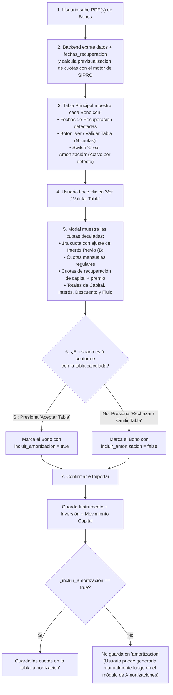

# Análisis y Plan de Implementación: Población de `fechas_recuperacion`, Previsualización Interactiva y Aprobación Opcional de Tabla de Amortización para Bonos

## 1. Respuestas Directas a tus Consultas

### 1.1. ¿Existe en el plan la posibilidad de visualizar la tabla completa antes de crearla y elegir si aceptarla o no?
En la versión inicial del plan solo se contemplaba mostrar un badge resumen con un tooltip, **pero tu requerimiento es totalmente factible y mucho más seguro operativamente**.

He actualizado este plan para incorporar **Previsualización Completa + Aprobación Independiente por Bono**:
1. **Cálculo en Previsualización (`preview`)**: Cuando subas el PDF del Bono, el backend extraerá las `fechas_recuperacion`, ejecutará en memoria el motor de cálculo de [`AmortizacionGeneracionController`](file:///c:/PROYECTOS/SIPRO_07/backend/app/Http/Controllers/API/AmortizacionGeneracionController.php) (sin guardar nada aún en la base de datos) y devolverá el **detalle completo de todas las cuotas** junto con sus totales (`Total Capital`, `Total Intereses`, `Total Descuento/Premio`, `Total Flujo`).
2. **Modal de Visualización y Validación en Pantalla**: En la columna **Amortización** de cada Bono habrá un botón **`Ver Tabla (N cuotas)`** que abrirá un diálogo interactivo mostrando:
   * Los parámetros detectados (`Fecha Emisión`, `Fecha Vencimiento`, `Fechas de Recuperación de Capital` —incluso permitiéndote editar las `fechas_recuperacion` y recalcular al instante si deseas probar un ajuste—).
   * La tabla completa cuota por cuota (`N° Cupón`, `Fecha Pago`, `Capital`, `Interés Parcial`, `Premio/Descuento`, `Interés Total`, `Flujo Total`), destacando la primera cuota (con el ajuste de `interes_acumulado_previo` $B$) y las cuotas donde se amortiza capital.
3. **Control para Aceptar o Rechazar (`incluir_amortizacion`)**:
   * Tanto dentro del modal como en la fila de la tabla principal tendrás un switch/botón claro:
     * ✅ **`Aceptar Tabla de Amortización`** (`incluir_amortizacion = true`): Al confirmar la importación, se creará el `instrumento`, la `inversion`, el `movimiento_capital` **y se guardará la tabla de amortización validada**.
     * ❌ **`Omitir Amortización (Generar manualmente después)`** (`incluir_amortizacion = false`): Si observas algún descuadre o prefieres ajustarla luego, desmarcas la tabla. Al confirmar la importación, el sistema registrará el `instrumento` (con sus `fechas_recuperacion`), la `inversion` y el `movimiento_capital`, pero **dejará la tabla `amortizacion` vacía para ese Bono**, permitiéndote ir después a la pantalla tradicional de *Generación de Tabla de Amortización* una vez hayas realizado cualquier ajuste manual.

---

### 1.2. ¿Al crear registros en la tabla `instrumento`, se consideró la población del campo `fechas_recuperacion`?
En la fase anterior únicamente se asignaba por defecto la fecha final de vencimiento (`'fechas_recuperacion' => $fechaVcto`).
* En los Bonos del Estado (especialmente los Bonos de Jubilados), el capital suele amortizarse en **2 o más pagos parciales** (semestrales o anuales tras un período de gracia).
* Con este plan, el parser extraerá automáticamente las `fechas_recuperacion` reales desde el PDF en dos niveles:
  * **Nivel 1 (Directo de la tabla del PDF en Págs. 9–10 si existe, sea BVG o BVQ)**: Extrae las fechas exactas de las filas donde `Amortización > 0.00`.
    * Ej. Liq. `28911-VRF32` (BVQ) $\rightarrow$ **`2028-10-28, 2029-04-28`**.
    * Ej. Liq. `376732` (BVG) $\rightarrow$ **`2029-11-07, 2030-05-07`**.
    * Ej. Liq. `376915` (BVG) $\rightarrow$ **`2029-10-28, 2030-04-28`**.
  * **Nivel 2 (Desde la Página 5 *"Formulario de Explicaciones"* de Santa Fe cuando el PDF no trae tabla, como en `442-VRF13`)**: Lee la periodicidad de pago de capital (`SEMESTRAL` / `ANUAL`) y los años de gracia (`5 AÑOS` en `442-VRF13`) y calcula las fechas exactas (`2031-09-05, 2032-09-05`).
* Además, si el instrumento ya existía en la base de datos pero tenía `fechas_recuperacion = NULL` (como ocurre actualmente con los instrumentos `#190` y `#43`), el sistema lo completará automáticamente.

---

### 1.3. ¿Por qué es mejor usar el motor del sistema (`AmortizacionGeneracionController`) que copiar la tabla del PDF?
1. **La tabla del PDF es Nominal del Título, NO Contable de tu Inversión**:
   * Los PDFs de BVG y BVQ imprimen la tabla sobre el 100% del Valor Nominal desde el cupón 1, sin considerar tu precio de compra con descuento, comisiones ni el reembolso del interés acumulado previo ($B$).
   * El motor de SIPRO ([`AmortizacionGeneracionController`](file:///c:/PROYECTOS/SIPRO_07/backend/app/Http/Controllers/API/AmortizacionGeneracionController.php)) calcula el `descuento` (premio por compra bajo la par), lo suma a `interes` en las cuotas de capital, y en la primera cuota vigente coloca el reembolso de `interes_acumulado_previo` ($B$) en `capital` y el `interes_primer_mes` en `interes`.
2. **Formatos distintos y tablas ausentes en PDFs**:
   * BVG y BVQ tienen estructuras de columnas diferentes, y algunos PDFs de BVQ (como `442-VRF13`, de 8 páginas) **no incluyen páginas de tabla de amortización**.

---

## 2. Flujo de Usuario Propuesto (Con Validación y Aceptación Previa)

---

## 3. Especificación Técnica de los Cambios

### Fase 1: Extracción de `fechas_recuperacion` en `BonoPdfParserService` (Backend)
1. En [`ParsedSettlementDto.php`](file:///c:/PROYECTOS/SIPRO_07/backend/app/Services/PdfParsers/DTOs/ParsedSettlementDto.php):
   * Agregar `?string $fechasRecuperacion = null`.
2. En [`BonoPdfParserService.php`](file:///c:/PROYECTOS/SIPRO_07/backend/app/Services/PdfParsers/BonoPdfParserService.php):
   * Implementar `extraerFechasRecuperacion(string $fullText, array $pagesText, string $bolsa, ?string $fechaEmision, ?string $fechaVencimiento)`:
     * **Nivel 1 (Desde tabla de amortización en Págs. 9–10 si existe)**:
       * Para **BVG**: Detecta filas con patrón `\b(\d{1,3})\s+(\d{2}-\d{2}-\d{4})\s+([0-9.,]+)\s+([0-9.,]+)\s+([0-9.,]+)` donde la 4ta columna (`Amortización`) sea $> 0$ y extrae la fecha (`DD-MM-YYYY` $\rightarrow$ `YYYY-MM-DD`).
       * Para **BVQ**: Detecta filas con amortización $> 0$ antes de la fecha de vencimiento del cupón y extrae las fechas en formato `YYYY-MM-DD`.
     * **Nivel 2 (Desde Página 5 / Página 6 del expediente de Santa Fe)**:
       * Si el PDF no tiene tabla de amortización (como `442-VRF13`), lee de la Página 5 la periodicidad de pago de capital (`SEMESTRAL` = 6 meses, `ANUAL` = 12 meses, `TRIMESTRAL` = 3 meses) y los años de gracia (`([0-9]+)\s*AÑOS` junto a `PERÍODO DE GRACIA`), generando las fechas desde `fechaEmision + añosGracia` hasta `fechaVencimiento`.

### Fase 2: Cálculo de Previsualización de Cuotas en `AmortizacionGeneracionController` y `InversionPdfImportService` (Backend)
1. En [`AmortizacionGeneracionController.php`](file:///c:/PROYECTOS/SIPRO_07/backend/app/Http/Controllers/API/AmortizacionGeneracionController.php):
   * Habilitar un método público reutilizable `calcularTablaDesdeObjetoInversion(Inversion $inversion, array $params): array` y `guardarTablaCalculada(Inversion $inversion, array $tabla, string $tipoAmortizacion = 'A'): array` para que tanto la pantalla manual de *Generación de Tabla de Amortización* como el *Importador de PDFs* utilicen exactamente la misma lógica sin duplicar código.
2. En [`InversionPdfImportService.php`](file:///c:/PROYECTOS/SIPRO_07/backend/app/Services/InversionPdfImportService.php):
   * Durante `preview()`:
     * Si el instrumento ya existe en BD y tiene `fechas_recuperacion`, usa ese valor; si el instrumento existente tiene `fechas_recuperacion` vacío (`NULL`) o es un instrumento nuevo, usa las `$dto->fechasRecuperacion` extraídas del PDF.
     * Construye en memoria una instancia temporal de `Inversion` + `Instrumento` con los datos del PDF y llama a `calcularTablaDesdeObjetoInversion()` (`frecuencia_pago = 1, cuotas_diferir = 0, tipo_amortizacion = 'A'`).
     * Incluye en cada ítem de `previewItems`:
       * `'fechas_recuperacion' => $fechasRecuperacion`
       * `'incluir_amortizacion' => true` (por defecto marcado, modificable por el usuario en la UI)
       * `'tabla_amortizacion_preview' => $tablaCalculada` (con el arreglo completo `cuotas` y los totales `total_capital`, `total_intereses`, `total_descuento`, `fecha_inicio`, `fecha_fin`).
   * Durante `confirm()`:
     * Al crear o actualizar el `instrumento` del Bono, guarda `fechas_recuperacion` (si el usuario lo editó en la previsualización o si estaba `NULL` en BD).
     * Verifica la bandera booleana `$item['incluir_amortizacion']`:
       * Si es `true`: genera y guarda las cuotas en la tabla `amortizacion` usando `guardarTablaCalculada()`.
       * Si es `false`: **omite la inserción en `amortizacion`** y deja registrada únicamente la inversión y su movimiento de capital, lista para ser procesada manualmente cuando lo desees.

### Fase 3: Modal de Visualización y Aceptación/Rechazo en Frontend (Angular)
1. En [`importar-pdf.component.html`](file:///c:/PROYECTOS/SIPRO_07/frontend/src/app/modules/notas-credito/importar-pdf/importar-pdf.component.html) y [`importar-pdf.component.ts`](file:///c:/PROYECTOS/SIPRO_07/frontend/src/app/modules/notas-credito/importar-pdf/importar-pdf.component.ts):
   * En la columna **Fechas / Vcto**:
     * Mostrar las fechas de recuperación detectadas: `Recup. Cap: 2029-11-07, 2030-05-07`.
   * En la columna **Amortización** para Bonos:
     * Mostrar un botón interactivo **`Ver Tabla (43 cuotas)`** junto con un indicador del estado de aceptación:
       * Badge verde `Tabla Aceptada (Se creará)` cuando `item.incluir_amortizacion === true`.
       * Badge gris/ámbar `Tabla Omitida (Manual)` cuando `item.incluir_amortizacion === false`.
   * **Nuevo Modal (`p-dialog`) de Previsualización de Tabla de Amortización**:
     * **Encabezado**: Muestra los datos del Bono (Liquidación, Comitente, Valor Nominal, Capital Invertido, Tasa Cupón, Interés Acumulado Previo $B$, Fechas de Recuperación de Capital).
     * **Tarjetas de Resumen**:
       * `Total Cuotas Vigentes` (ej. `43 cuotas`)
       * `Total Capital` (ej. `$26,625.45` incluyendo reembolso de interés previo $B$)
       * `Total Intereses Netos` (ej. `$6,714.72`)
       * `Total Premio / Descuento` (ej. `$1,138.65`)
       * `Flujo Total a Recibir` (ej. `$33,340.17`)
     * **Tabla scrolleable**: Muestra todas las cuotas (`# Cupón`, `Fecha Pago`, `Capital`, `Interés Parcial`, `Descuento (Premio)`, `Interés Total`, `Flujo Total`), resaltando con color celeste la primera cuota (con ajuste de interés acumulado previo) y con color verde las cuotas de recuperación de capital.
     * **Pie del Modal (Botones de Decisión)**:
       * Botón **`Omitir Tabla (Generar manualmente luego)`**: Pone `item.incluir_amortizacion = false` y cierra el modal.
       * Botón **`Aceptar Tabla de Amortización`**: Pone `item.incluir_amortizacion = true` y cierra el modal.
