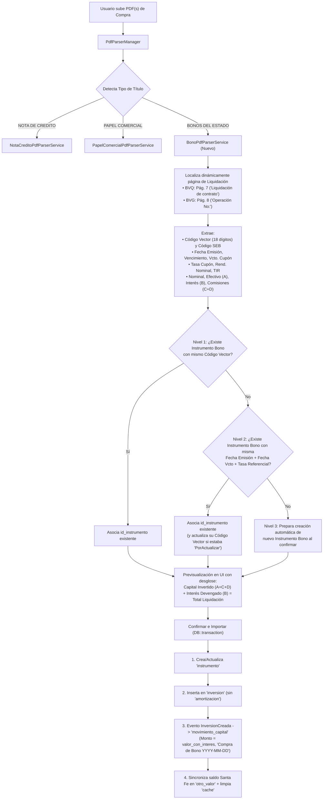

# Plan de Implementación: Carga Automática de Liquidaciones PDF para Bonos del Estado (`id_tipo_inversion = 4`)

## 1. Resumen Ejecutivo y Alcance
El objetivo es extender el motor de importación de liquidaciones bursátiles en PDF de SIPRO para procesar automáticamente compras de **Bonos del Estado (Deuda Interna)** negociadas a través de **Santa Fe Casa de Valores S.A.** tanto en la **Bolsa de Valores de Quito (BVQ)** como en la **Bolsa de Valores de Guayaquil (BVG)**.

### Consideraciones Clave Definidas
1. **Validación y Resolución Inteligente del Instrumento (`instrumento`) en 2 Niveles**:
   * **Nivel 1 (Primario — Vector de Precios)**: Buscar en `instrumento` (`id_tipo_inversion = 4`) por el **Código de Vector de Precios** (`codigo_titulo_vector`, ej. `045040100501300507` / `a045040100501300507`).
   * **Nivel 2 (Respaldo — Atributos Financieros)**: Si no se encuentra por código vector (o si el instrumento existente tiene `codigo_titulo_vector = 'PorActualizar'`), buscar un instrumento de tipo Bono (`id_tipo_inversion = 4`) que coincida exactamente en **`fecha_emision`**, **`fecha_vencimiento`** y **`tasa_referencial`** (tasa cupón). Si hace match en Nivel 2 y el PDF trae el vector de precios, se actualizará automáticamente el `codigo_titulo_vector` y `codigo_seb` del instrumento existente.
   * **Nivel 3 (Creación Automática)**: Si no existe por ninguno de los dos criterios, el sistema creará el nuevo registro en `instrumento` al confirmar la importación (asociado a `id_emisor = 45` `MINISTERIO DE ECONOMIA Y FINANZAS`).
2. **Desglose Financiero de Bonos (Capital vs. Interés Acumulado Previo)**:
   * A diferencia de los Papeles Comerciales Cero Cupón y las Notas de Crédito, la liquidación de un Bono incluye **Intereses Devengados / Acumulados ($B$)** que el comprador paga al vendedor:
     $$\text{Capital Invertido (Costo Base)} = \text{Valor Efectivo }(A) + \text{Comisión Bolsa }(C) + \text{Comisión Operador }(D)$$
     $$\text{Valor con Interés (Total Liquidación)} = \text{Capital Invertido} + \text{Interés Acumulado Previo }(B)$$
3. **Registro Contable en `movimiento_capital` y Sincronización en `otro_valor`**:
   * Se dispara el evento `InversionCreada` para registrar el egreso (`id_tipo_movimiento = 181`, `id_signo = 191`) por el **`valor_con_interes`** ($A + B + C + D$, que es el desembolso real en efectivo debitado en Santa Fe Casa de Valores, tal como están registrados los movimientos `#407` al `#415` de las compras de octubre 2026) con la glosa `"Compra de Bono YYYY-MM-DD"`.
   * Se sincroniza automáticamente el saldo disponible **"Fondos en Santa Fe"** del titular en la tabla `otro_valor`.
4. **Exclusión Explícita de Alcance**:
   * **No se generarán registros en la tabla `amortizacion`** para los Bonos en esta fase.

---

## 2. Evaluación de Tablas del Sistema: ¿Hay alguna otra tabla que se deba considerar?

Se realizó una auditoría completa de las tablas y procedimientos almacenados de `sipro_desa` para verificar el impacto de registrar compras de Bonos sin incluir aún la tabla `amortizacion`:

| # | Tabla / Objeto | ¿Se debe actualizar al importar el PDF de Bono? | Rol y Comportamiento en el Sistema |
| :--- | :--- | :---: | :--- |
| **1** | **`instrumento`** | **SÍ** | Almacena la serie del Bono del Estado (`id_tipo_inversion = 4`, `id_emisor = 45`). Se valida primero por `codigo_titulo_vector` y luego por `(fecha_emision, fecha_vencimiento, tasa_referencial)`. Si el instrumento tenía `'PorActualizar'` en su vector o código SEB, se enriquece automáticamente con el dato oficial del PDF. |
| **2** | **`inversion`** | **SÍ** | Almacena la operación de compra (`id_estado_inversion = 128` Activa). Guarda tanto `capital_invertido` ($A+C+D$, para el Patrimonio Base) como `interes_acumulado_previo` ($B$) y `valor_con_interes` ($A+B+C+D$, para el flujo de caja). Además guarda `tasa_interes` (cupón), `rendimiento_nominal`, `rendimiento_efectivo` (TIR), `fecha_primer_pago` (vencimiento del cupón vigente), `interes_mensual` e `interes_primer_mes`. |
| **3** | **`movimiento_capital`** | **SÍ** | Registra el egreso de efectivo en Santa Fe (`id_tipo_movimiento = 181` `COM_INV`, `id_signo = 191` `-`). El listener [`CrearMovimientoCompraInversion`](file:///c:/PROYECTOS/SIPRO_07/backend/app/Listeners/CrearMovimientoCompraInversion.php#L62) ya toma `$inversion->valor_con_interes ?? $inversion->capital_invertido`, por lo que al poblar `valor_con_interes` ($A+B+C+D$) debitará exactamente el Total Liquidación del PDF y generará la descripción `"Compra de Bono YYYY-MM-DD"`. |
| **4** | **`otro_valor`** | **SÍ** | Recalcula automáticamente el saldo disponible del comitente en **"Fondos en Santa Fe"** (`id_tipo_otro_valor` `142` Argentina, `143` Cristian, `144` Isabel, `145` Jhon), reflejando de inmediato la reducción de liquidez en el rubro `Total Corriente`. |
| **5** | **`cache`** | **SÍ** | Se invalida la caché de `PatrimonioController` para que el Dashboard y el reporte de Patrimonio Consolidado reflejen el nuevo Bono al instante. |
| **6** | **`amortizacion`** | **NO (Excluida por ahora)** | **Impacto de no cargarla en este momento**:<br/>• **Lo que SÍ se actualiza de inmediato**: El rubro **`Capital bonos`** y el **`Patrimonio Base (Costo)`** en `SP_PATRIMONIO_CONSOLIDADO` leen directamente `SUM(I.capital_invertido)` desde la tabla `inversion` (`WHERE INS.id_tipo_inversion = 4 AND I.id_estado_inversion = 128`). Por lo tanto, el capital del Bono aparecerá inmediatamente en el Patrimonio Consolidado.<br/>• **Lo que queda pendiente hasta cargar `amortizacion`**: Los rubros **`Intereses esperados`** (proyección a 1 año), **`Bonos vencimiento próximo`** y el calendario de **Vencimientos Semanales/Mensuales** consultan la tabla `amortizacion`. Esos flujos futuros de cupones se sumarán cuando posteriormente se genere o cargue la tabla de amortización del Bono. |
| **7** | **`emisor`** | **Solo lectura (`id_emisor = 45`)** | Todos los Bonos del Estado en `sipro_desa` (incluidos los emitidos bajo decretos 2026 donde BVG imprime *"MINISTERIO DE DESARROLLO ECONÓMICO Y PRODUCTIVO"*) se asocian al emisor institucional `id_emisor = 45` (`MINISTERIO DE ECONOMIA Y FINANZAS`). |

---

## 3. Flujo de Procesamiento y Validación de Instrumento



---

## 4. Diseño Técnico Detallado

### 4.1. Nuevo Parser: `BonoPdfParserService.php`
Se creará [`backend/app/Services/PdfParsers/BonoPdfParserService.php`](file:///c:/PROYECTOS/SIPRO_07/backend/app/Services/PdfParsers) implementando [`PdfSettlementParserInterface`](file:///c:/PROYECTOS/SIPRO_07/backend/app/Services/PdfParsers/PdfSettlementParserInterface.php):

1. **Detección (`canHandle`)**:
   * Verifica que sea un expediente de compra de Santa Fe Casa de Valores (`SANTA FE` + `COMPRADOR`) y que contenga indicadores de Bono del Estado: `BONOS DEL ESTADO`, `BONO ESTADO`, `RESUMEN ESPECÍFICO DE BONO ASIGNADO`, `Tipo de Instrumento : BONO` o `Tipo Título Valor: BONOS`.
2. **Localización Dinámica de la Página de Liquidación Bursátil**:
   * En los PDFs de Bonos de **BVG** (`376732`, `376915`), las páginas 6 y 7 contienen el *"Resumen Específico de Bono Asignado"* y la *"Declaración de Licitud de Fondos"*, desplazando la liquidación oficial de BVG a la **Página 8** (`$pagesText[7]`), mientras que en **BVQ** (`28911`, `442`) está en la **Página 7** (`$pagesText[6]`).
   * El parser recorrerá `$pagesText` buscando la página exacta que contenga los encabezados oficiales de liquidación (`Operación No:` + `Valor Efectivo:` para BVG; `Liquidación de contrato:` + `Valor efectivo (A)` para BVQ).
3. **Reglas de Extracción por Bolsa**:

| Campo en SIPRO | Origen en PDF **BVQ** (Quito) | Origen en PDF **BVG** (Guayaquil) |
| :--- | :--- | :--- |
| **`liquidacion`** | `Compra N0. 28911 - VRF32` $\rightarrow$ `28911 - VRF32` | `Operación No: 376732` $\rightarrow$ `376732` |
| **`codigoVector`** | `Código vector 045040100101290428` (18 dígitos) | `Código vector precio : 045040100501300507` (18 dígitos) |
| **`codigoSeb`** | Pág. 1 / Pág. 4 / Pág. 5: `(BYJ)`, `(BYN)` | Pág. 1 / Pág. 4 / Pág. 6: `BYP`, `BYR` |
| **`fechaCompra`** | `Fecha Valor` (`26/Nov/2025`) | `Fecha valor` / `Fecha de negociación` (`21/10/2026`) |
| **`fechaEmision`** | `Fecha emisión` (`28/Abr/2025` / `05/May/2025`) | `Emisión de título` (`07/05/2026` / `28/04/2026`) |
| **`fechaVencimiento`** | `Fecha vencimiento` (`28/Abr/2029` / `05/May/2032`) | `Vencimiento título` (`07/05/2030` / `28/04/2030`) |
| **`fechaPrimerPago`** | `Cupón actual` (`28/Nov/2025` / `05/Feb/2026`) | `Vcto. Cupón` (`07/11/2026` / `28/10/2026`) |
| **`tasaInteres`** *(Cupón)* | `Interes Nominal (%)` (`7.13` / `7.54`) | `Tasa interés vigente` (`6.820000%`) |
| **`rendimientoNominal`** | `RDTO. Nominal (%)` (`11.00` / `12.00`) | `Rend. Nominal` (`8.40000000%`) |
| **`rendimientoEfectivo`** | `TIR / TEA (%)` (`11.5719` / `12.6825`) | `Rend. Efectivo` (`8.73106619%`) |
| **`plazoDias`** | `Plazo por vencer` (`1249` / `2309`) | `Plazo por vencer` (`1416` / `1405`) |
| **`valorNominal`** | `Val. Nom. actual` (`1,200.00` / `11,648.72`) | `Valor Nominal` (`26,550.00` / `5,775.00`) |
| **`precioCompra`** | `Precio (%)` (`88.858973` / `83.599068`) | `Precio` (`95.47263092%` / `96.38775753%`) |
| **`valorEfectivo`** ($A$) | `Valor efectivo (A)` (`1,066.31` / `9,738.22`) | `Valor Efectivo` (`25,347.98` / `5,566.39`) |
| **`interesDevengado`** ($B$) | `Monto interés(B)` (`6.37` / `10.09`) | `Intereses devengados` (`75.45` / `28.59`) |
| **`comisionBolsa`** ($C$) | `Bolsa(C)` (`4.00` / `4.87`) | `Comisión Bolsa` (`12.67` / `4.00`) |
| **`comisionCasaValores`** ($D$) | `Operador(D)` (`15.00` / `20.13`) | `Comisión Casa de Valores` (`50.70` / `12.02`) |
| **`capitalInvertido`** ($A+C+D$) | `round(A + C + D, 2)` (`1,085.31` / `9,763.22`) | `round(A + C + D, 2)` (`25,411.35` / `5,582.41`) |
| **`valorConInteres`** ($A+B+C+D$) | `Total a Pagar (A+B+C+D)` (`1,091.68` / `9,773.31`) | `Total Comprador Neto` (`25,486.80` / `5,611.00`) |

---

### 4.2. Extensión del DTO: `ParsedSettlementDto.php`
Se añadirán en [`ParsedSettlementDto.php`](file:///c:/PROYECTOS/SIPRO_07/backend/app/Services/PdfParsers/ParsedSettlementDto.php) las propiedades opcionales específicas de Bonos:
* `?string $codigoVector = null` (ej. `'045040100501300507'`)
* `?string $codigoSeb = null` (ej. `'BYP'`)
* `?float $rendimientoNominal = null` (ej. `8.40`)
* `?float $rendimientoEfectivo = null` (ej. `8.73106619`)
* `?float $interesDevengado = null` ($B$, ej. `75.45`)
* `?float $valorConInteres = null` ($A+B+C+D$, ej. `25486.80`)
* `?string $fechaPrimerPago = null` (Fecha de vencimiento del cupón en curso, ej. `'2026-11-07'`)

---

### 4.3. Lógica de Validación de Instrumento y Persistencia en `InversionPdfImportService.php`

#### A. Método `resolverInstrumentoBono()` (En `preview` y `confirm`)
1. **Búsqueda Nivel 1 (Por Vector de Precios)**:
   * Normaliza el código vector extraído quitando cualquier prefijo `'a'` (`$rawVector = ltrim(trim($codigoVector), 'aA')`).
   * Consulta en `instrumento`:
     ```php
     Instrumento::where('id_tipo_inversion', 4)
         ->where('eliminado', 0)
         ->whereIn('codigo_titulo_vector', [$rawVector, 'a' . $rawVector])
         ->first();
     ```
2. **Búsqueda Nivel 2 (Por Fecha de Emisión + Fecha de Vencimiento + Tasa Referencial)**:
   * Si Nivel 1 no retorna coincidencia, consulta en `instrumento`:
     ```php
     Instrumento::where('id_tipo_inversion', 4)
         ->where('eliminado', 0)
         ->whereDate('fecha_emision', $fechaEmision)
         ->whereDate('fecha_vencimiento', $fechaVencimiento)
         ->whereRaw('ABS(tasa_referencial - ?) < 0.001', [$tasaInteres])
         ->first();
     ```
   * **Enriquecimiento automático**: Si se encuentra el instrumento por Nivel 2 y su `codigo_titulo_vector` actual es `'PorActualizar'` o vacío (como ocurre hoy en `id_instrumento = 179`), al confirmar la importación se actualizará automáticamente con `'a' . $rawVector` y su `codigo_seb`.
3. **Creación Nivel 3 (Nuevo Instrumento de Bono)**:
   * Si no existe ni por Nivel 1 ni por Nivel 2, en `preview` se informa `"Se creará nuevo instrumento: YYYY-MM-DD BONOS DEL ESTADO YYYY-MM-DD (Vector: a...)"` y en `confirm` se crea con:
     * `id_emisor = 45` (`MINISTERIO DE ECONOMIA Y FINANZAS`)
     * `id_tipo_inversion = 4` (`BONO`)
     * `codigo_titulo = 'INV_4_' . str_replace('-', '', $fechaVencimiento)`
     * `nombre = "{$fechaEmision} BONOS DEL ESTADO {$fechaVencimiento}"`
     * `fecha_emision = $fechaEmision`
     * `fecha_vencimiento = $fechaVencimiento`
     * `tasa_referencial = $tasaInteres`
     * `codigo_titulo_vector = $rawVector ? ('a' . $rawVector) : 'PorActualizar'`
     * `codigo_seb = $codigoSeb ?: 'PorActualizar'`
     * `fechas_recuperacion = $fechaVencimiento`
     * `activo = 1`, `eliminado = 0`

#### B. Cálculos al Guardar en `inversion` (`confirm`)
Para `tipo_titulo === 'BONO'` (`id_tipo_inversion = 4`):
* `valor_nominal` = `monto_a_negociar` = `$valorNominal`
* `valor_efectivo` = `valor_sin_comision` = `$valorEfectivo` ($A$)
* `comision_bolsa` = `$comisionBolsa` ($C$)
* `comision_casa_valores` = `$comisionCasaValores` ($D$)
* `total_comisiones` = `round($comisionBolsa + $comisionCasaValores, 2)` ($C+D$)
* `capital_invertido` = `saldo_capital_actual` = `round($valorEfectivo + $totalComisiones, 2)` ($A+C+D$)
* `interes_acumulado_previo` = `$interesDevengado` ($B$)
* `valor_con_interes` = `round($capitalInvertido + $interesDevengado, 2)` ($A+B+C+D$)
* `tasa_interes` = `$tasaInteres` (Tasa cupón vigente)
* `rendimiento_nominal` = `$rendimientoNominal`
* `rendimiento_efectivo` = `$rendimientoEfectivo`
* `fecha_primer_pago` = `$fechaPrimerPago` (Vencimiento del cupón actual)
* `interes_mensual` = `round(($valorNominal * ($tasaInteres / 100)) / 12, 2)`
* `interes_primer_mes` = `round($interesMensual - $interesDevengado, 2)`
* **Sin inserción en `amortizacion`**: Se asegura que el bloque de creación de cuota única en `confirm()` se ejecute exclusivamente para `PAPEL_COMERCIAL` (`id_tipo_inversion === 3`).

---

### 4.4. Ajustes en Frontend (Angular)
En [`pdf-import.service.ts`](file:///c:/PROYECTOS/SIPRO_07/frontend/src/app/core/pdf-import.service.ts), [`importar-pdf.component.ts`](file:///c:/PROYECTOS/SIPRO_07/frontend/src/app/modules/notas-credito/importar-pdf/importar-pdf.component.ts) e [`importar-pdf.component.html`](file:///c:/PROYECTOS/SIPRO_07/frontend/src/app/modules/notas-credito/importar-pdf/importar-pdf.component.html):
1. **Soporte para `tipo_titulo = 'BONO'`**:
   * Badge distintivo (ej. morado/índigo con ícono `bi-bank`) para `Bono del Estado`.
   * Mostrar debajo del instrumento el **Código Vector** detectado y si el instrumento **Ya existe** (`ID #232 - Match por Vector` / `Match por Fechas+Tasa`) o si **Se creará nuevo**.
   * Mostrar la **Tasa Cupón** y el **Rendimiento Nominal (YTM)**.
2. **Visibilidad de Interés Devengado y Total Liquidación**:
   * En la columna de **Capital Invertido**, cuando el ítem sea un Bono (`interes_acumulado_previo > 0`), mostrar:
     * **Capital ($A+C+D$)**: `$25,411.35`
     * **Int. Devengado ($B$)**: `+$75.45`
     * **Total Liq. ($A+B+C+D$)**: `$25,486.80` (indicando que este es el valor debitado en Movimientos de Capital).
3. **Columna Amortización**:
   * Para Bonos mostrará un badge informativo: `Pendiente (Sin tabla amort.)`.

---

## 5. Plan de Pruebas y Verificación
1. **Prueba automatizada de Parsing y Resolución de Instrumento** con los 4 PDFs reales en `documentacion/Bonos/`:
   * `06_2025_11_26_LIQ_28911_VRF32_CompraBono_OrellanaCristian.pdf` (BVQ) $\rightarrow$ Verifica match con `id_instrumento = 169` (`a045040100101290428`) y detección de duplicado contra `id_inversion = 296`.
   * `2026_01_08_LIQ_442_VRF13_CompraBono_OrellanaJhon.pdf` (BVQ) $\rightarrow$ Verifica match por **Nivel 2 (Fechas + Tasa 7.54%)** con `id_instrumento = 179` (que tiene `codigo_titulo_vector = 'PorActualizar'`) y detección de duplicado contra `id_inversion = 310`.
   * `Firmado_Firmado_Compra-Bono-Argentina Campaña-Liq-376732-SFV.pdf` (BVG) $\rightarrow$ Verifica match por **Nivel 1 (Vector `045040100501300507`)** con `id_instrumento = 232` y detección de duplicado contra `id_inversion = 752`.
   * `Firmado_Firmado_Compra-Bono-Jhon Orellana-Liq-376915-SFV.pdf` (BVG) $\rightarrow$ Verifica match por **Nivel 1 (Vector `045040100501300428`)** con `id_instrumento = 242` y detección de duplicado contra `id_inversion = 757`.
2. **Limpieza post-prueba**: Garantizar que ninguna prueba deje registros residuales en la base de datos.
