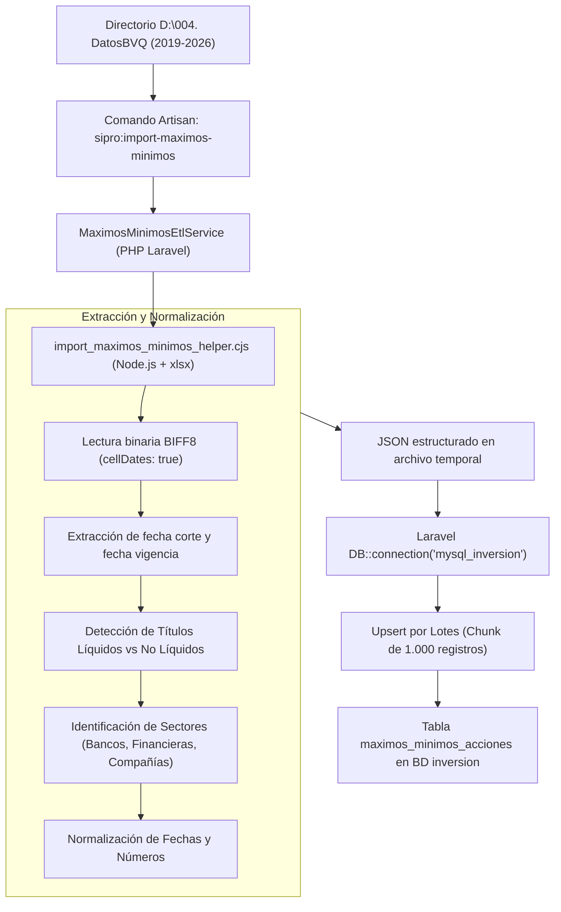

# Análisis e Implementación: Módulo de Importación de Precios Máximos y Mínimos de Acciones (BVQ)

## 1. Resumen Ejecutivo y Objetivo

El presente documento detalla el análisis técnico de los reportes oficiales diarios **`maximos-y-minimos_<fecha>.xls`** emitidos por la **Bolsa de Valores de Quito (BVQ)** a través del **Sistema Electrónico Bursátil (SEB)**, así como el diseño e implementación del módulo de extracción, transformación y carga (ETL) automatizado hacia la base de datos **`inversion`** del ecosistema **SIPRO**.

### Objetivo Principal
Almacenar, estructurar y mantener de forma histórica e idempotente los precios de cierre, bandas de fluctuación diaria (precios máximos y mínimos permitidos de $\pm 10\%$), volúmenes y fechas de negociación de todos los títulos de renta variable ecuatorianos desde el año **2019 hasta el 2026**.

---

## 2. Análisis Estructural del Archivo de la BVQ

### 2.1. Propósito Bursátil del Archivo
En el mercado de valores ecuatoriano, el comité de operaciones bursátiles establece rangos máximos y mínimos de variación de precios para las acciones con el fin de evitar fluctuaciones desordenadas o manipulación de mercado. Este reporte diario:
1. Publica los límites de precios válidos para ingresar posturas u órdenes en la siguiente rueda de negociación.
2. Separa los títulos entre **Líquidos** (con banda activa del $+10\%$ y $-10\%$) y **No Líquidos** (donde no aplica banda porcentual fija automática).
3. Mantiene el precio oficial de cierre vigente y la referencia del volumen y fecha en que se formó dicho precio.

### 2.2. Estructura de Hojas del Libro Excel
El archivo es un libro de formato binario **Microsoft Excel 97-2004 (BIFF8 / OLE2)** que consta de dos hojas:
* **`MAX-MIN BVQ`**: Hoja principal con las tablas tabulares de los títulos bursátiles.
* **`NOTA`**: Plantilla de notas reglamentarias y operativas de la rueda.

### 2.3. Secciones y Agrupaciones en la Hoja `MAX-MIN BVQ`
* **Bloque 1: TÍTULOS LÍQUIDOS**: Acciones de alta rotación (ej: *Banco Guayaquil, Produbanco, Banco Pichincha, Banco Bolivariano, Corporación Favorita, Holcim Ecuador, Inversancarlos, Natluk*). Disponen de cálculo explícito en las columnas de Precio Máximo y Mínimo.
* **Bloque 2: TÍTULOS NO LÍQUIDOS**: Acciones o valores con rotación esporádica (ej: *Banco del Austro, Cervecería Nacional, Conclina, fondos de inversión inmobiliarios/colectivos*). Las columnas de máximos y mínimos permanecen vacías.

Dentro de cada bloque, las entidades se agrupan por sector económico:
* **BANCOS**
* **FINANCIERAS**
* **COMPAÑÍAS / FONDOS DE INVERSIÓN**

### 2.4. Diccionario de Columnas

| Posición | Encabezado en Excel | Campo en BD | Tipo | Descripción |
| :---: | :--- | :--- | :---: | :--- |
| **Col B** | `ENTIDAD EMISORA` | `emisor` | `VARCHAR(255)` | Nombre o razón social de la entidad emisora. |
| **Col C** | `CODIGO EN SEB` | `codigo_seb` | `VARCHAR(30)` | Nemotécnico bursátil oficial (ej. `GYL`, `SLU`, `PCD`, `HLE`). |
| **Col D** | `VALOR NOMINAL` | `valor_nominal` | `DECIMAL(14,4)` | Valor a la par por título emitido en USD. |
| **Col E** | `PRECIO DE CIERRE` | `precio_cierre` | `DECIMAL(14,4)` | Último precio de cierre oficial registrado en el mercado. |
| **Col F** | `PRECIO MAXIMO` | `precio_maximo` | `DECIMAL(14,4)` | Límite superior permitido para la siguiente sesión ($Cierre + 10\%$). |
| **Col G** | `PRECIO MINIMO` | `precio_minimo` | `DECIMAL(14,4)` | Límite inferior permitido para la siguiente sesión ($Cierre - 10\%$). |
| **Col H** | `No. DE ACC ULT. CIERRE` | `num_acc_ult_cierre` | `DECIMAL(18,2)` | Cantidad de acciones con las que se fijó el último precio de cierre. |
| **Col I** | `FECHA DE ULT. CIERRE` | `fecha_ult_cierre` | `DATE` | Fecha en la que se estableció el precio de cierre oficial. |
| **Col J** | `FECHA DE ULT. NEGOC.` | `fecha_ult_negoc` | `DATE` | Fecha de la última transacción efectiva en el SEB. |
| **Col K** | `PRECIO DE CIERRE BVQ` | `precio_cierre_bvq` | `DECIMAL(14,4)` | Precio de cierre registrado específicamente en la Bolsa de Quito. |
| **Col L** | `No DE ACC. ULTIMO BVQ` | `num_acc_ult_bvq` | `DECIMAL(18,2)` | Cantidad de acciones en la última operación de BVQ. |
| **Col M** | `FECHA DE ULT. CIERRE BVQ`| `fecha_ult_cierre_bvq` | `DATE` | Fecha del último cierre en la Bolsa de Quito. |

---

## 3. Diagnóstico y Variaciones de Archivos Históricos en Disco

Los archivos residen en la unidad `D:\004. DatosBVQ` y abarcan desde 2019 hasta 2026. Durante el análisis se detectaron variaciones en las rutas y formatos según el año:

1. **Años 2022 al 2026:**
   * Ruta estructurada: `D:\004. DatosBVQ\AAAA\AAAA_MM\AAAA_MM_DD\001_InformacionContinua\maximos-y-minimos_AAAA_MM_DD.xls`.
2. **Años 2019 y 2021:**
   * Archivo ubicado directamente en la carpeta del día: `D:\004. DatosBVQ\AAAA\AAAA_MM\AAAA_MM_DD\maximos-y-minimos.xls`.
3. **Año 2020 (Variación de nomenclatura):**
   * Subcarpetas con formato `MM_DD`: `D:\004. DatosBVQ\2020\2020_04\04_01\001_InformacionContinua\maximos-y-minimos.xls`.
   * El algoritmo de extracción implementado resuelve dinámicamente el año desde el nivel superior de carpetas y el mes/día desde el nivel inferior, o alternativamente a partir del valor de `fecha_vigencia` contenido en el encabezado del archivo.

---

## 4. Diseño del Esquema de Base de Datos (`inversion`)

Se creó la tabla **`maximos_minimos_acciones`** en la base de datos **`inversion`** mediante la migración [2026_11_22_150000_create_maximos_minimos_acciones_table.php](file:///c:/PROYECTOS/SIPRO_07/backend/database/migrations/2026_11_22_150000_create_maximos_minimos_acciones_table.php).

### Estructura DDL Implementada
```sql
CREATE TABLE `maximos_minimos_acciones` (
  `id` BIGINT UNSIGNED NOT NULL AUTO_INCREMENT,
  `fecha_informacion` DATE NOT NULL,
  `fecha_vigencia` DATE DEFAULT NULL,
  `es_liquido` TINYINT(1) NOT NULL DEFAULT 0,
  `sector` VARCHAR(50) DEFAULT NULL,
  `emisor` VARCHAR(255) NOT NULL,
  `codigo_seb` VARCHAR(30) NOT NULL,
  `valor_nominal` DECIMAL(14,4) NOT NULL DEFAULT 0.0000,
  `precio_cierre` DECIMAL(14,4) DEFAULT NULL,
  `precio_maximo` DECIMAL(14,4) DEFAULT NULL,
  `precio_minimo` DECIMAL(14,4) DEFAULT NULL,
  `num_acc_ult_cierre` DECIMAL(18,2) DEFAULT NULL,
  `fecha_ult_cierre` DATE DEFAULT NULL,
  `fecha_ult_negoc` DATE DEFAULT NULL,
  `precio_cierre_bvq` DECIMAL(14,4) DEFAULT NULL,
  `num_acc_ult_bvq` DECIMAL(18,2) DEFAULT NULL,
  `fecha_ult_cierre_bvq` DATE DEFAULT NULL,
  `archivo_origen` VARCHAR(255) DEFAULT NULL,
  `created_at` TIMESTAMP NULL DEFAULT NULL,
  `updated_at` TIMESTAMP NULL DEFAULT NULL,
  PRIMARY KEY (`id`),
  UNIQUE KEY `maxmin_fecha_codigo_unique` (`fecha_informacion`, `codigo_seb`),
  KEY `maxmin_fecha_informacion_index` (`fecha_informacion`),
  KEY `maxmin_fecha_vigencia_index` (`fecha_vigencia`),
  KEY `maxmin_codigo_seb_index` (`codigo_seb`),
  KEY `maxmin_es_liquido_index` (`es_liquido`),
  KEY `maxmin_sector_index` (`sector`)
) ENGINE=InnoDB DEFAULT CHARSET=utf8mb4 COLLATE=utf8mb4_unicode_ci;
```

> [!IMPORTANT]
> **Idempotencia Garantizada:** El índice único compuesto `UNIQUE(fecha_informacion, codigo_seb)` permite ejecutar el proceso de carga múltiples veces o de forma recurrente sin generar duplicados, actualizando los registros existentes mediante la cláusula `ON DUPLICATE KEY UPDATE` (`upsert`).

---

## 5. Arquitectura del Flujo ETL



### Componentes Creados:
1. **Migración Laravel:**  
   [2026_11_22_150000_create_maximos_minimos_acciones_table.php](file:///c:/PROYECTOS/SIPRO_07/backend/database/migrations/2026_11_22_150000_create_maximos_minimos_acciones_table.php)
2. **Modelo Eloquent:**  
   [MaximoMinimoAccion.php](file:///c:/PROYECTOS/SIPRO_07/backend/app/Models/MaximoMinimoAccion.php) con conexión dedicada `mysql_inversion`.
3. **Parser Node.js Ultrarrápido:**  
   [import_maximos_minimos_helper.cjs](file:///c:/PROYECTOS/SIPRO_07/backend/app/Services/import_maximos_minimos_helper.cjs) con rendimiento medio de ~50 ms por archivo Excel binario.
4. **Servicio ETL:**  
   [MaximosMinimosEtlService.php](file:///c:/PROYECTOS/SIPRO_07/backend/app/Services/MaximosMinimosEtlService.php) con soporte individual y por lote (`--batch`).
5. **Comando de Consola Artisan:**  
   [ImportMaximosMinimosCommand.php](file:///c:/PROYECTOS/SIPRO_07/backend/app/Console/Commands/ImportMaximosMinimosCommand.php).

---

## 6. Resultados de la Carga Masiva (2019 al 2026)

Se procesaron **1.756 archivos diarios** correspondientes a **8 años de historial bursátil**, con **0 errores**.

### Métricas de Ejecución por Año:

| Año | Archivos en Disco | Archivos Procesados | Errores | Registros en BD | Tiempo de Ejecución |
| :---: | :---: | :---: | :---: | :---: | :---: |
| **2019** | 77 | 77 | 0 | 5.005 | 8.66 seg |
| **2020** | 239 | 239 | 0 | 15.651 | 29.90 seg |
| **2021** | 251 | 251 | 0 | 16.767 | 48.55 seg |
| **2022** | 246 | 246 | 0 | 16.937 | 51.08 seg |
| **2023** | 236 | 236 | 0 | 17.087 | 51.74 seg |
| **2024** | 249 | 249 | 0 | 18.987 | 42.31 seg |
| **2025** | 240 | 240 | 0 | 18.168 | 14.36 seg |
| **2026** | 218 | 218 | 0 | 18.374 | 5.99 seg |
| **TOTAL** | **1.756** | **1.756** | **0** | **126.976** | **~4.5 min** |

### Resumen Consolidado en Base de Datos:
* **Total de registros en `maximos_minimos_acciones`:** **126.976**
* **Rango de fechas:** Desde `2019-09-03` hasta `2026-11-19`
* **Ruedas bursátiles / días distintos:** **1.734**
* **Nemotécnicos bursátiles distintos:** **101**
* **Emisores únicos:** **103**
* **Distribución por sector:**
  * Compañías / Fondos: 107.285 registros
  * Bancos: 12.457 registros
  * Financieras: 7.234 registros

---

## 7. Guía de Operación y Comandos

Para ejecutar o programar el proceso desde la terminal del backend (`c:\PROYECTOS\SIPRO_07\backend`):

### Importar todos los años (Carga masiva o resincronización):
```bash
php artisan sipro:import-maximos-minimos --all
```

### Importar un año específico:
```bash
php artisan sipro:import-maximos-minimos --year=2026
```

### Importar una fecha específica:
```bash
php artisan sipro:import-maximos-minimos --date=2026-01-05
```

### Importar un archivo diario individual:
```bash
php artisan sipro:import-maximos-minimos "D:\004. DatosBVQ\2026\2026_11\2026_11_22\001_InformacionContinua\maximos-y-minimos_2026_11_22.xls"
```

### Importar una carpeta personalizada:
```bash
php artisan sipro:import-maximos-minimos --dir="D:\004. DatosBVQ\2026\2026_11"
```
