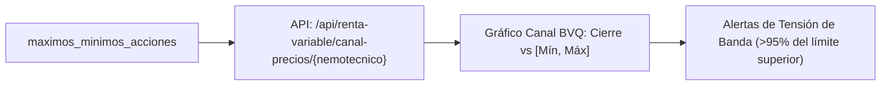
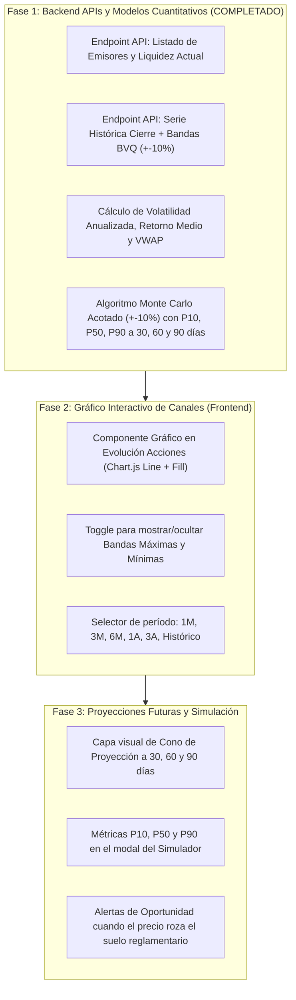

# Propuestas de Nuevos Desarrollos y Explotación Analítica: Historial de Máximos y Mínimos (BVQ 2019–2026)

## 1. Introducción y Contexto de la Base de Datos

Con la estructuración y carga inicial de la tabla **`inversion.maximos_minimos_acciones`**, el ecosistema **SIPRO** ahora dispone de **126.976 registros históricos** que cubren de manera ininterrumpida **1.734 ruedas bursátiles** (septiembre 2019 a noviembre 2026) para **101 nemotécnicos bursátiles y 103 emisores**.

A diferencia de las cotizaciones aisladas, este conjunto de datos ofrece una riqueza cuantitativa única:
1. **Precio de Cierre Oficial:** El valor con el que formalmente concluyó cada jornada.
2. **Bandas Reglamentarias de Fluctuación ($\pm 10\%$):** El precio máximo y mínimo autorizado por la BVQ para la siguiente sesión en títulos líquidos.
3. **Volumen de Formación:** Cantidad de acciones con las que se marcó el precio (`num_acc_ult_cierre`).
4. **Fechas Operativas Disociadas:** Permite contrastar la `fecha_informacion` con la `fecha_ult_negoc`, lo que permite medir empíricamente la **inactividad y latencia de liquidez** de cada acción.

A continuación, se presentan las propuestas de desarrollo técnico y analítico organizadas en cuatro ejes estratégicos.

---

## 2. Eje 1: Visualizaciones y Gráficos Avanzados

### 2.1. Gráfico de Canal Bursátil y Túnel de Cotización (Envelopes $\pm 10\%$)
* **Descripción:** Implementar en el módulo de Renta Variable un gráfico interactivo (Chart.js / ApexCharts) que contraste día por día el precio de cierre real frente al canal de fluctuación autorizado por la BVQ.
* **Componentes visuales:**
  * **Línea continua central (Verde/Azul):** Precio de Cierre real (`precio_cierre`).
  * **Banda superior discontinua (Rojo o Ámbar):** Límite máximo operativo (`precio_maximo`).
  * **Banda inferior discontinua (Verde tenue):** Límite mínimo operativo (`precio_minimo`).
  * **Área sombreada entre bandas:** Representa el túnel regulatorio oficial de la sesión.
  * **Barras de Volumen inferiores:** Cantidad de acciones transadas (`num_acc_ult_cierre`).
* **Valor analítico para el inversor:** Permite detectar de inmediato cuándo una acción cerró en "techo de banda" (señal de presión compradora acumulada sin oferta) o en "suelo de banda" (presión vendedora).



### 2.2. Semáforo Dinámico de Liquidez y Profundidad
* **Métrica calculada:** $\Delta_{\text{inactividad}} = \text{fecha\_informacion} - \text{fecha\_ult\_negoc}$.
* **Visualización:** Badge / Indicador de estado en las tarjetas del Radar:
  * 🟢 **Alta Liquidez:** Negociada en las últimas 48–72 horas.
  * 🟡 **Liquidez Moderada:** Sin transacciones entre 4 y 15 días hábiles.
  * 🔴 **Baja Rotación / Ilíquida:** Más de 15 días sin marcar operaciones.
* **Histograma de Rotación:** Gráfico de distribución de días de inactividad entre negociaciones efectivas para evaluar el riesgo de liquidez al momento de querer salir de una posición.

---

## 3. Eje 2: Modelos Cuantitativos y Proyecciones de Precios Futuros

Teniendo 8 años de precios diarios ($N = 1.734$ sesiones), es posible alimentar modelos estocásticos y estadísticos rigurosos:

### 3.1. Simulación Monte Carlo Acotada por Regulación BVQ
* **Fundamento Matemático:** Modelo de Movimiento Browniano Geométrico (GBM):
  $$S_{t+\Delta t} = S_t \cdot \exp\left( \left(\mu - \frac{\sigma^2}{2}\right)\Delta t + \sigma \sqrt{\Delta t} \cdot Z \right)$$
  Donde:
  * $\mu$: Deriva o retorno medio diario histórico de la acción.
  * $\sigma$: Volatilidad histórica anualizada calculada con la serie 2019–2026.
  * $Z \sim \mathcal{N}(0, 1)$: Variable aleatoria normal estándar.
* **Ajuste Regulatorio Ecuatoriano (Innovación Clave):**
  A diferencia de los modelos para Wall Street, en Ecuador ninguna acción puede variar más de $\pm 10\%$ en un solo día. Por tanto, en cada paso de tiempo simulado $t+1$:
  $$S_{t+1}^{\text{sim}} = \max\left(S_t \cdot 0.90, \, \min\left(S_t \cdot 1.10, \, S_{t+1}^{\text{GBM}}\right)\right)$$
* **Resultado para el Usuario:**
  Un gráfico tipo "abanico" o cono de probabilidad a 30, 60 y 90 días proyectados mostrando:
  * **Percentil 90 (P90 - Escenario Optimista)**
  * **Percentil 50 (P50 - Mediana / Escenario Más Probable)**
  * **Percentil 10 (P10 - Escenario Conservador / Suelo de Seguridad)**

### 3.2. Bandas de Volatilidad Histórica y Estimación de Precios Extremos (VaR)
* **Value at Risk (VaR 95% y 99%):** Determinar la máxima pérdida esperada en 1 mes para una cartera accionaria basado en los peores descensos diarios históricos de la BVQ.
* **Rango de Negociación Esperado a 1 Mes:** Proyección de la banda superior e inferior donde con un 95% de confianza estadística oscilará el precio en las próximas 20 sesiones bursátiles.

---

## 4. Eje 3: Integración Operativa en Pantallas Existentes de SIPRO

| Módulo Actual en SIPRO | Funcionalidad a Incorporar con la Nueva Tabla |
| :--- | :--- |
| **Radar de Oportunidades & Portafolio** (`DividendRadarComponent`) | 1. Mostrar el rango del día: *«Banda hoy: \$178.20 – \$217.80»*.<br>2. Alerta de postura: si el usuario simula una compra fuera de banda, avisar que la BVQ rechazaría la orden.<br>3. Ratio de Proximidad al Mínimo Anual de 52 semanas. |
| **Evolución Acciones** (`EvolucionAccionesComponent`) | 1. Selector de capas en el gráfico: `[ Cierre ]`, `[ Canal BVQ ±10% ]`, `[ Cono Proyección Monte Carlo ]`.<br>2. Selector de horizontes: 1 Año, 3 Años, 5 Años, Todo el Histórico (2019-2026). |
| **Simulador de Inversión y Reinversión** | Contrastar el precio simulado contra la mediana histórica proyectada para advertir sobrevaloración o descuento relativo. |
| **Generador de Mensajes IA (ChatGPT)** | Enriquecer el contexto analítico del prompt: *"Produbanco cotiza a \$198.00 con un rango autorizado para mañana de \$178.20 a \$217.80, habiendo cerrado 3 días consecutivos con tendencia alcista."* |

---

## 5. Eje 4: Hoja de Ruta de Implementación Propuesta (Fases)



---

## 6. Endpoints Implementados (Fase 1 Completada)

### 6.1. `GET /api/renta-variable/maximos-minimos/emisores`
Retorna los 101 nemotécnicos con su último cierre, banda del día, días de inactividad de mercado y clasificación de liquidez (`ALTA`, `MODERADA`, `BAJA`).

### 6.2. `GET /api/renta-variable/maximos-minimos/canal/{codigoSeb}?periodo=1y&proyeccion=true`
Retorna la serie temporal día por día, métricas estadísticas cuantitativas y la simulación Monte Carlo acotada.

**Ejemplo de respuesta en producción:**
```json
{
  "success": true,
  "metadata": {
    "codigo_seb": "PCD",
    "emisor": "BANCO PICHINCHA",
    "sector": "BANCOS",
    "es_liquido": true,
    "periodo_consultado": "1y",
    "fecha_inicio": "2025-11-19",
    "fecha_fin": "2026-11-19",
    "total_sesiones": 244
  },
  "metricas": {
    "precio_actual": 198.0,
    "volatilidad_anualizada_pct": 36.81,
    "retorno_acumulado_periodo_pct": 117.58,
    "vwap_precio_ponderado": 197.82,
    "banda_actual_bvq": {
      "minimo_autorizado": 178.2,
      "maximo_autorizado": 217.8,
      "tension_banda": "NEUTRO"
    },
    "dias_inactividad_mercado": 0
  },
  "proyeccion_monte_carlo": {
    "precio_base": 198.0,
    "dias_proyectados": 90,
    "iteraciones_monte_carlo": 500,
    "hitos_resumen": {
      "30d": {
        "fecha_estimada": "2026-12-31",
        "escenario_pesimista_p10": 186.41,
        "escenario_base_p50": 217.36,
        "escenario_optimista_p90": 258.06,
        "variacion_base_pct": 9.78
      },
      "60d": {
        "fecha_estimada": "2027-02-11",
        "escenario_pesimista_p10": 188.95,
        "escenario_base_p50": 235.16,
        "escenario_optimista_p90": 301.28,
        "variacion_base_pct": 18.77
      },
      "90d": {
        "fecha_estimada": "2027-03-25",
        "escenario_pesimista_p10": 200.21,
        "escenario_base_p50": 259.06,
        "escenario_optimista_p90": 347.90,
        "variacion_base_pct": 30.84
      }
    }
  }
}
```

### 6.3. `GET /api/renta-variable/maximos-minimos/proyeccion/{codigoSeb}?dias=90`
Endpoint directo y ligero para recalcular simulaciones estocásticas con horizontes variables.
  "total_sesiones": 248,
  "volatilidad_anualizada_pct": 14.85,
  "retorno_acumulado_pct": 8.20,
  "dias_sin_negociacion_actual": 0,
  "proyeccion_30d": {
    "escenario_pesimista_p10": 184.50,
    "escenario_base_p50": 199.20,
    "escenario_optimista_p90": 215.80
  },
  "series": [
    {
      "fecha": "2026-11-19",
      "precio_cierre": 198.00,
      "precio_maximo": 217.80,
      "precio_minimo": 178.20,
      "num_acciones": 23.00,
      "es_liquido": 1
    }
  ]
}
```

---

## 7. Fase 2 Implementada: Componente Frontend Interactivo (Angular + PrimeNG + Chart.js)

En la Fase 2 se construyó y desplegó la interfaz gráfica completa para la explotación de los datos analíticos:

1. **Servicio Angular:**
   * Archivo: `frontend/src/app/core/maximos-minimos.service.ts`
   * Consume los endpoints analíticos de la Fase 1 (`getEmisores`, `getCanalHistorico`, `getProyeccion`).

2. **Componente Visual:**
   * Archivo: `frontend/src/app/modules/renta-variable/canal-bursatil/canal-bursatil.component.ts|html|css`
   * **Buscador y Selector de 101 Emisores:** Filtro interactivo con badges de liquidez.
   * **5 Tarjetas KPI SIPRO:**
     * Precio Cierre Oficial y retorno acumulado en el período.
     * Banda Diaria BVQ ($\pm 10\%$) con indicador de tensión (Normal / Techo / Suelo).
     * Volatilidad anualizada con semáforo de riesgo.
     * VWAP histórico y gap de precio.
     * Semáforo de liquidez y conteo de días de inactividad transcurridos.
   * **Gráfico Interactivo (Chart.js):**
     * Precio real de cierre día por día.
     * Bandas regulatorias BVQ con área de sombreado.
     * Cono probabilístico Monte Carlo acotado (P10, P50 mediana, P90 optimista).
     * Eje secundario para volumen transado en cada sesión.
   * **Panel de Hitos Cuantitativos:** Escenarios a 30 días, 60 días y 90 días con variaciones porcentuales estimadas y ficha técnica del modelo GBM.
   * **Tabla Histórica de Sesiones:** Con paginación, filtros y exportación nativa a Excel.

3. **Navegación y Rutas:**
   * Ruta: `/renta-variable/canal-bursatil` registrada en `app.routes.ts`.
   * Elemento de menú en `sidebar.component.ts`: "Canal Bursátil & Proyecciones" bajo el módulo **Renta Variable**.

---

## 8. Fase 3 Implementada: Integración Operativa Transversal en SIPRO

En la Fase 3 se integraron los datos cuantitativos y regulatorios de la BVQ en las pantallas y flujos operativos existentes:

1. **Radar de Acciones y Dividendos (`DividendRadarComponent`):**
   * **Banda del Día en Tarjeta:** Cada tarjeta del Radar y del Portafolio muestra ahora la banda oficial autorizada: `Banda BVQ: $min – $max (±10%)`.
   * **Semáforo de Tensión de Banda:** Distintivos visuales automáticos cuando la cotización toca los extremos:
     * `🟢 Suelo BVQ: Posible Descuento` (cierre $\le 1.02 \times \text{mínimo}$).
     * `🔴 Techo BVQ: Sobrecompra` (cierre $\ge 0.98 \times \text{máximo}$).
   * **Navegación Fluida:** Nuevo botón `📈 Canal` en cada tarjeta para saltar directamente a la vista analítica del nemotécnico consultado (`/renta-variable/canal-bursatil?emisor=TICKER`).

2. **Simulador de Inversión y Reinversión (Modal Operativo):**
   * **Campo de Precio de Postura:** Permite al inversor simular compras a un precio propuesto diferente al último cierre.
   * **Control de Restricción Regulatoria BVQ:** Si el precio de postura está fuera del margen del $\pm 10\%$, la interfaz emite una alerta preventiva:  
     *«⚠️ Restricción Regulatoria BVQ: El precio ingresado ($X.XX) se encuentra fuera del rango reglamentario de la BVQ ($min – $max). La rueda bursátil rechazaría una postura fuera de esta banda (±10%).»*
   * **Proyección Monte Carlo a 90 Días Integrada:** Tarjeta estocástica que muestra el Escenario Base P50 (Mediana), Escenario Pesimista P10 y Optimista P90, con el valor proyectado en dólares del portafolio simulado.

3. **Asistente IA (Generador de Consultas ChatGPT):**
   * El prompt generado automáticamente inyecta ahora:
     * Banda reglamentaria del día ($\pm 10\%$).
     * Nemotécnico bursátil oficial.
     * Estado de tensión de banda (Suelo / Techo / Neutro).

---

## 9. Conclusión
La explotación de la tabla `maximos_minimos_acciones` a lo largo de las **Fases 1, 2 y 3** ha transformado a **SIPRO** en una plataforma integral pionera en Ecuador: combina el registro histórico de 126.976 ruedas con modelos estocásticos predictivos (Monte Carlo acotado) y controles regulatorios en tiempo real en cada postura de inversión.
