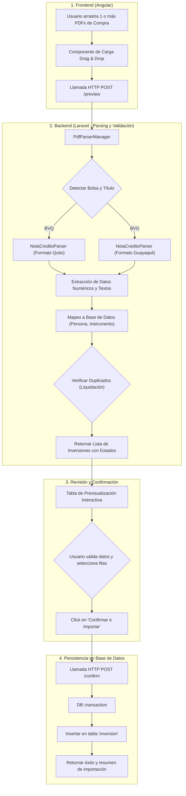

# Plan de Implementación: Módulo de Importación y Lectura Automática de Liquidaciones PDF

## 1. Resumen Ejecutivo y Objetivo
El objetivo de este módulo es automatizar el registro de compras de inversiones en el sistema **SIPRO** mediante la lectura e interpretación directa de los documentos PDF de liquidación bursátil generados por **Santa Fe Casa de Valores S.A.** (negociados en la **Bolsa de Valores de Quito - BVQ** y la **Bolsa de Valores de Guayaquil - BVG**).

En esta primera etapa, el módulo se centra en **Notas de Crédito Desmaterializadas (SRI)**, con una arquitectura basada en el patrón *Strategy* que permitirá extender fácilmente la lectura hacia **Bonos, Papeles Comerciales y Titularizaciones** en etapas posteriores.

---

## 2. Flujo de Trabajo del Módulo

---

## 3. Especificación Técnica de Componentes

### 3.1. Backend (Laravel 12 / PHP 8.2)

#### A. Dependencia de Extracción de Texto
* Utiliza `smalot/pdfparser` configurado con `$config->setRetainImageContent(false)`.
* **Ventaja**: Extracción 100% nativa en el servidor PHP, procesamiento ultra liviano (8-10 MB por PDF de 8 páginas) y en menos de 1 segundo por archivo.

#### B. Capa de Servicios de Parsing (`app/Services/PdfParsers/`)
1. **`Contracts/PdfSettlementParserInterface.php`**:
   * Interfaz común para estandarizar los métodos `canHandle(string $text, array $pagesText): bool` y `parse(string $filename, string $fullText, array $pagesText): ParsedSettlementDto`.
2. **`DTOs/ParsedSettlementDto.php`**:
   * DTO que encapsula todos los campos financieros extraídos del PDF.
3. **`NotaCreditoPdfParserService.php`**:
   * Parser especializado en los expedientes de Santa Fe Casa de Valores para Notas de Crédito.
   * Lógica de discriminación de bolsa:
     * **BVQ**: Extrae la liquidación con patrón `([0-9]{4,6}\s*-\s*VRF[0-9]{2})` de la cabecera de la Bolsa de Quito.
     * **BVG**: Extrae la liquidación numérica directa `Operación No:\s*([0-9]{6})` de la cabecera de la Bolsa de Guayaquil.
   * Extracción de datos clave:
     * **Cédula/RUC del Comitente**: Patrón en página 1 y 7.
     * **Fecha de Negociación**: Formato `DD/MM/YYYY` o `DD-MM-YYYY` normalizado a `YYYY-MM-DD`.
     * **Valor Nominal**: Monto facial del título.
     * **Precio de Compra (%)**: Porcentaje de negociación.
     * **Valor Efectivo**: Monto desembolsado por el título.
     * **Comisión de Bolsa**: Monto en dólares (0,02% FVE).
     * **Comisión de Casa de Valores**: Monto en dólares (variable o tarifa mínima de \$2).
     * **Total Comprador (Capital Invertido)**: Costo total de adquisición.
     * **Precio Neto Compra (%)**: Rendimiento/costo neto real.
     * **Factura de Bolsa**: Número de factura electrónica asociada.
4. **`PdfParserManager.php`**:
   * Gestor/Fábrica que recibe el archivo PDF, extrae el texto y determina qué *parser* debe procesarlo según el contenido.

#### C. Capa de Importación y Negocio (`app/Services/InversionPdfImportService.php`)
* **Método `preview(array $uploadedFiles)`**:
  * Parsea cada archivo.
  * Busca al comitente en la tabla `persona` mediante el número de cédula (`id_propietario`).
  * Obtiene el `id_grupo_familiar` de la relación `grupo_familiar_persona`.
  * Consulta si el campo `inversion.liquidacion` ya existe en la base de datos (marca estado `DUPLICADO` o `VALIDO`).
  * Asigna por defecto `id_instrumento = 222` (`SRI 2034-12-31`) e `id_tipo_inversion = 91`.
  * Valida que la suma matemática cuadre:
    $$\text{Capital Invertido} = \text{Valor Efectivo} + \text{Comisión Bolsa} + \text{Comisión Operador}$$
* **Método `confirm(array $inversionesData)`**:
  * Ejecuta una transacción (`DB::transaction`).
  * Inserta los registros aprobados en la tabla `inversion` con `id_estado_inversion = 128` (Vigente).
  * No crea registros en `amortizacion` (cumpliendo con el desacople de Notas de Crédito).

#### D. Endpoints API (`app/Http/Controllers/API/InversionPdfImportController.php`)
| Método | Endpoint | Descripción |
| :--- | :--- | :--- |
| `POST` | `/api/inversiones/importar-pdf/preview` | Recibe archivos PDF vía `multipart/form-data`, procesa y devuelve el listado de datos listos para validar. |
| `POST` | `/api/inversiones/importar-pdf/confirm` | Recibe la lista confirmada de inversiones y las registra en la base de datos. |

---

### 3.2. Frontend (Angular)

#### A. Ubicación y Navegación
* Ruta: `/notas-credito/importar-pdf`
* Accesible en el menú lateral bajo **Notas de Crédito > Carga Liquidaciones PDF**.

#### B. Componente Principal (`importar-pdf.component`)
1. **Zona de Carga (Drag & Drop)**:
   * Área interactiva para arrastrar uno o múltiples archivos `.pdf` simultáneamente.
   * Botón para examinar carpetas locales.
   * Barra de progreso indeterminada durante el análisis.
2. **Tarjetas de Métricas en Tiempo Real**:
   * Total de archivos cargados.
   * Total de liquidaciones válidas para importar.
   * Total de liquidaciones ya registradas (duplicados prevenidos).
   * Total de capital invertido seleccionado.
3. **Tabla de Previsualización y Control**:
   * Checkbox de selección por fila y cabecera con selección masiva.
   * Badge de Bolsa: `BVQ` (azul) o `BVG` (cian).
   * Selector dinámico de propietario (detectado por cédula, editable antes de guardar).
   * Columnas numéricas detalladas: Nominal, Precio %, Comisión Bolsa, Comisión Operador, Capital Invertido, Precio Neto %.
   * Badge de estado interactivo: `Válido`, `Ya Registrado (#ID)` o `Error`.
   * Botón para descartar filas individuales.
4. **Acción de Confirmación**:
   * Botón "Confirmar e Importar X Inversiones" que inserta en base de datos y redirige a la pantalla de Venta Agrupada.

---

## 4. Estado de Ejecución de las Fases

- [x] **Fase 1: Servicio de Parsing y Validación en Backend**
  - [x] Instalación y configuración de memoria de `smalot/pdfparser`.
  - [x] Creación de `PdfSettlementParserInterface` y `ParsedSettlementDto`.
  - [x] Creación de `NotaCreditoPdfParserService` con soporte para BVQ y BVG.
  - [x] Creación de `PdfParserManager`.
  - [x] Pruebas exitosas de extracción al 100% con los 4 PDFs reales.

- [x] **Fase 2: Lógica de Negocio y Endpoints REST**
  - [x] Creación de `InversionPdfImportService` con resolución de comitentes por cédula y detección de duplicados.
  - [x] Creación de `InversionPdfImportController` (`preview` y `confirm`).
  - [x] Registro y verificación de rutas en `backend/routes/api.php`.
  - [x] Pruebas de integración HTTP del endpoint `/preview` con detección automática de duplicados (#762, #724, #737, #719).

- [x] **Fase 3: Pantalla e Integración en Frontend**
  - [x] Creación de servicio `PdfImportService` en Angular.
  - [x] Creación del componente `ImportarPdfComponent` (`.ts`, `.html`, `.css`).
  - [x] Registro de ruta `/notas-credito/importar-pdf` en `frontend/src/app/app.routes.ts`.
  - [x] Incorporación en el menú de navegación lateral `sidebar.component.ts`.
  - [x] Compilación exitosa del bundle de Angular (`ng build`) sin errores.

- [x] **Fase 4: Verificación Integrada**
  - [x] Validación de flujo integral de punta a punta.
