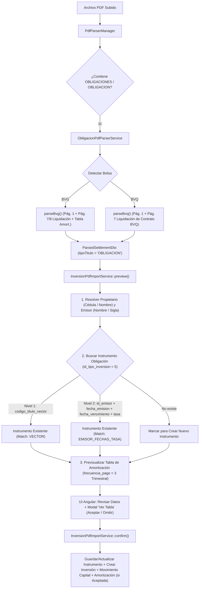

# Plan de Implementación: Carga Automática de PDFs de Obligaciones Corporativas (`OBLIGACION`)

## 1. Objetivo y Alcance
Incorporar en el módulo de **Carga Automática de Liquidaciones PDF** el soporte integral para expedientes firmados de **Obligaciones Corporativas** (`id_tipo_inversion = 5`, código `OBLI`), tanto de la **Bolsa de Valores de Guayaquil (BVG)** como de la **Bolsa de Valores de Quito (BVQ)**, garantizando:

1. **Detección y Extracción Dual (BVG y BVQ)** de todos los campos financieros y operativos del expediente.
2. **Validación de Instrumento en 2 Niveles** antes de crear uno nuevo:
   - **Nivel 1**: Por **Código de Vector de Precios** (`codigo_titulo_vector`, normalizando el prefijo `'a'`).
   - **Nivel 2**: Por **Emisor (`id_emisor`) + Fecha de Emisión (`fecha_emision`) + Fecha de Vencimiento (`fecha_vencimiento`) + Tasa Referencial (`tasa_referencial`)** en instrumentos de tipo Obligación (`id_tipo_inversion = 5`). *(Fundamental para casos de mercado primario donde la Bolsa aún no asigna código vector en el PDF, como la liquidación `362003` de TELCONET).*
3. **Soporte para Mercado Primario (`100%` por amortizar) y Mercado Secundario (`< 100%` por amortizar)**:
   - Cuando la obligación ya ha amortizado cuotas previas (ej. liquidación `3761513` de EMPAGRAN con `Saldo por amortizar: 50.02%`), utilizar el **`Monto a negociar` / `Val. Nom. actual` (`$2,113.34`)** como capital nominal vigente de la inversión.
4. **Registro Automático en `movimiento_capital` y `otro_valor`**:
   - Creación automática del egreso `COM_INV` (`id_tipo_movimiento = 181`, signo `NEGATIVO = 191`) por el **Total Comprador Neto (`valor_con_interes = A + B + C + D`)** con descripción `"Compra de Obligación YYYY-MM-DD"`, actualizando el saldo disponible de la persona en **Santa Fe Casa de Valores** (`otro_valor`).
5. **Previsualización y Validación de la Tabla de Amortización**:
   - Generación en memoria de la tabla de amortización (según la frecuencia detectada en el PDF, por defecto **Trimestral** `frecuencia_pago = 3`) y visualización en el modal interactivo **`Ver Tabla (N)`**, permitiendo **Aceptar** u **Omitir (Manual)** la creación de las cuotas antes de confirmar.

---

## 2. Arquitectura y Flujo de Resolución

---

## 3. Diseño Detallado por Componente

### 3.1. Backend: Nuevo Parser [`ObligacionPdfParserService.php`](file:///c:/PROYECTOS/SIPRO_07/backend/app/Services/PdfParsers/ObligacionPdfParserService.php)

Se creará la clase `App\Services\PdfParsers\ObligacionPdfParserService` implementando [`PdfSettlementParserInterface`](file:///c:/PROYECTOS/SIPRO_07/backend/app/Services/PdfParsers/Contracts/PdfSettlementParserInterface.php) y se registrará en [`PdfParserManager.php`](file:///c:/PROYECTOS/SIPRO_07/backend/app/Services/PdfParsers/PdfParserManager.php).

#### A. Regla de Detección (`canHandle`)
- Excluye documentos que correspondan a `NOTA DE CREDITO`, `PAPEL COMERCIAL` o `BONOS DEL ESTADO` (`COMPRA BONO`, `RESUMEN ESPECIFICO DE BONO`).
- Detecta positivamente documentos que contengan:
  - `COMPRA OBLIGACIONES` o `COMPRA OBLIGACION` (Págs. 1 y 3 de Santa Fe).
  - `TÍTULO VALOR: OBLIGACIONES` / `TITULO VALOR: OBLIGACIONES` (Liquidación BVG).
  - `TÍTULO: OBLIGACIONES` / `CLASE` + `OBLIGACIONES` (Liquidación BVG / BVQ).

#### B. Extracción en Bolsa de Valores de Guayaquil (`parseBvg`)
Localiza dinámicamente la página de liquidación oficial de la BVG (normalmente Pág. 7) y extrae:
- **Liquidación**: `Operación No: (\d{5,8})` (ej. `367834`, `3761513`, `362003`, `343466`, `343465`).
- **Comitente y Cédula/RUC**: Desde Pág. 1 y Factura BVG (Pág. 9).
- **Emisor**: Desde `Emisor: ...` en Pág. 7 (ej. `BLUE ENERGY CONSTRUCTION AND INTEGRATION S.A`, `EMPACADORA GRUPO GRANMAR S.A. EMPAGRAN`, `TELCONET S.A.`).
- **Código Vector de Precio**: `Código vector precio : ([0-9]{15,20})` (ej. `669010100001330311`, `526010100001280408`, `056010100001280205`, o `null` si viene en blanco como en `362003`).
- **Código SEB**: Extraído de Pág. 1/4/5 (ej. `OGG`).
- **Fechas**:
  - `fecha_compra`: `Fecha de negociación: DD/MM/YYYY` (ej. `2026-05-21`).
  - `fecha_emision`: `Emisión de título: DD/MM/YYYY` (ej. `2026-03-11`).
  - `fecha_vencimiento`: `Vencimiento título: DD/MM/YYYY` (ej. `2033-03-11`).
  - `fecha_primer_pago`: `Vcto. Cupón: DD/MM/YYYY` (ej. `2026-06-11`).
- **Tasas y Plazo**:
  - `tasa_interes`: `Tasa interés vigente:` (ej. `9.00%`).
  - `rendimiento_nominal`: `Rend. Nominal:` (ej. `9.75%`, `10.25%`, `11.50%`).
  - `rendimiento_efectivo`: `Rend. Efectivo:` (ej. `10.11231255%`).
  - `plazo_dias`: `Plazo por vencer:` (ej. `2450`, `535`, `1052`, `997`, `1060`).
- **Valor Nominal Vigente (`Monto a negociar`)**:
  - Extrae `Valor nominal: $ X` y `Monto a negociar: $ Y`.
  - Si `Monto a negociar` está presente y es menor al `Valor nominal` (caso de compra secundaria con amortizaciones previas como `3761513` donde Nominal = `$4,225.00` y Monto a negociar = `$2,113.34`), se asigna **`$2,113.34`** como `valorNominal` para SIPRO, conservando el nominal original en `rawMetadata['valor_nominal_original']`.
- **Importes y Comisiones**:
  - `precioCompra`: `(?<!sucio:)Precio:` (ej. `97.93512553%`).
  - `valorEfectivo`: `(A)VALOR EFECTIVO` (ej. `$15,179.94`).
  - `interesDevengado`: `(B) VALOR INTERÉS` (ej. `$271.25`).
  - `comisionBolsa`: `(C) BOLSA` (ej. `$9.00`).
  - `comisionCasaValores`: `(D) OPERADOR` *(soportando tanto el formato con porcentaje `(D) OPERADOR 0.25000 37.95` como el formato de comisión mínima fija sin porcentaje `(D) OPERADOR 10.00` visto en la liquidación `3761513`)*.
  - `totalInvertido` (`capital_invertido` SIPRO): `A + C + D` (ej. `$15,226.89`).
  - `valorConInteres` (`TOTAL COMPRADOR NETO`): `A + B + C + D` (ej. `$15,498.14`).
  - `precioNetoCompra`: `(capital_invertido / valor_nominal) * 100`.
- **Frecuencia de Pago (`frecuenciaPago`)**:
  - Lee de Pág. 5 (`TRIMESTRAL`, `MENSUAL`, `SEMESTRAL`, `ANUAL`) o calcula la diferencia en meses entre los cupones consecutivos de la Pág. 8 (por defecto `3` = Trimestral para Obligaciones).

#### C. Extracción en Bolsa de Valores de Quito (`parseBvq`)
Dado que el comprobante *"LIQUIDACIÓN DE CONTRATO"* de la **BVQ** para Obligaciones tiene la misma estructura tabular que el de Bonos en la BVQ, reutilizará los patrones probados en `BonoPdfParserService::parseBvq()`:
- **Liquidación**: `Compra N0. XXXXX - VRFXX` (normalizado a `XXXXX-VRFXX`).
- **Emisor**: Extraído de la fila `Emisor` de la liquidación BVQ o del encabezado `COMPRA OBLIGACIONES <EMISOR>` en la Pág. 1 de Santa Fe.
- **Código Vector**: `Código vector` (18 dígitos).
- **Fechas**: `Quito, DM, DD-MM-YYYY` / `Fecha valor`, `Fecha emisión`, `Fecha vencimiento`, `Cupón actual` (`fecha_primer_pago`).
- **Tasas**: `Interes Nominal (%)`, `RDTO. Nominal (%)`, `TIR / TEA (%)`.
- **Montos**: `Val. Nom. actual` (que en BVQ ya representa el saldo nominal vigente a negociar), `Precio (%)`, `Valor efectivo (A)`, `Monto interés (B)`, `Bolsa (C)`, `Operador (D)`, `Total comprador (A+B+C+D-RO-RB)`.

---

### 3.2. Backend: Resolución de Emisor, Instrumento, Movimiento de Capital y Amortización en [`InversionPdfImportService.php`](file:///c:/PROYECTOS/SIPRO_07/backend/app/Services/InversionPdfImportService.php)

#### 1. Mejora en `resolverEmisor()` para Nombres Corporativos Largos
En los PDFs de la BVG los nombres de los emisores vienen con su razón social completa:
- PDF: `"BLUE ENERGY CONSTRUCTION AND INTEGRATION S.A"` → En BD (`emisor #152`): `nombre = "BLUE ENERGY"`, `sigla = "BLUEENERGY"`.
- PDF: `"EMPACADORA GRUPO GRANMAR S.A. EMPAGRAN"` → En BD (`emisor #146`): `nombre = "EMPAGRAN"`, `sigla = "EMPAGRAN"`.
- PDF: `"TELCONET S.A."` → En BD (`emisor #151`): `nombre = "TELCONET"`, `sigla = "TELCONET"`.

Nuestro método actual `resolverEmisor()` busca si el texto del PDF contiene `$e->nombre` o `$e->sigla`, lo cual **ya hace match directo con los 3 emisores** (`BLUE ENERGY`, `EMPAGRAN` y `TELCONET`). Adicionalmente, si en el futuro compras una obligación de un emisor que aún no exista en la tabla `emisor`, el selector de **Emisor** estará disponible en la vista previa o se podrá crear/seleccionar.

#### 2. Validación de Instrumento Obligación en 2 Niveles (`buscarInstrumentoObligacion`)
Se implementará el método `buscarInstrumentoObligacion(?string $codigoVector, ?int $idEmisor, ?string $fechaEmision, ?string $fechaVencimiento, ?float $tasaReferencial)`:

1. **Nivel 1 (Por Vector de Precios)**:
   - Si `$codigoVector` no está vacío, busca en `instrumento` con `id_tipo_inversion = 5` y `activo = 1` donde `codigo_titulo_vector` coincida con `$rawVector`, `'a' . $rawVector` o `'A' . $rawVector`.
   - Si coincide, retorna `[$inst, 'VECTOR']`.
2. **Nivel 2 (Por Emisor + Fecha de Emisión + Fecha de Vencimiento + Tasa Referencial)**:
   - Si no hubo match por vector (ej. `362003` donde el vector viene vacío en el PDF), busca en `instrumento` con `id_tipo_inversion = 5`, `activo = 1`, `id_emisor = $idEmisor`, `fecha_emision = $fechaEmision`, `fecha_vencimiento = $fechaVencimiento` y `ABS(tasa_referencial - $tasaReferencial) < 0.001`.
   - Si coincide, retorna `[$inst, 'FECHAS_TASA']`.
   - Si en `confirm()` se encuentra por Nivel 2 y el instrumento tenía `codigo_titulo_vector` vacío o `'PorActualizar'`, y el PDF sí trae vector, lo actualiza automáticamente.
3. **Creación de Nuevo Instrumento (si no existe en Nivel 1 ni Nivel 2)**:
   - En `confirm()`, si no existe el instrumento, inserta en `instrumento`:
     - `id_emisor`: `$idEmisor`
     - `id_tipo_inversion`: `5` (`Obligacion`)
     - `codigo_titulo`: `'INV_5_' . str_replace('-', '', $fechaVcto)`
     - `nombre`: `"{$fechaEmi} {$nombreCortoEmisor} {$fechaVcto}"` (siguiendo el estándar exacto de tu base de datos: ej. `2026-03-11 BLUE ENERGY 2033-03-11`)
     - `fecha_emision`: `$fechaEmi`
     - `fecha_vencimiento`: `$fechaVcto`
     - `tasa_referencial`: `$tasaInteres`
     - `fechas_recuperacion`: `null` (en Obligaciones todas las cuotas trimestrales amortizan capital, por lo que `AmortizacionGeneracionController` genera las fechas automáticamente cada 3 meses).
     - `codigo_titulo_vector`: `$codigoVector ? ('a' . $codigoVector) : 'PorActualizar'`
     - `codigo_seb`: `$codigoSeb ?: 'OGG'`
     - `activo`: `1`

#### 3. Cálculos de Inversión y Movimiento de Capital para Obligaciones (`id_tipo_inversion = 5`)
Al igual que en Bonos, las Obligaciones tienen cupón e interés acumulado previo (`(B) VALOR INTERÉS`), por lo que en `confirm()`:
- `valor_nominal` = `$valorNominal` (que corresponde al `Monto a negociar` vigente).
- `monto_a_negociar` = `$valorNominal`.
- `valor_efectivo` = `$valorEfectivo` (`A`).
- `valor_sin_comision` = `$valorEfectivo` (`A`).
- `capital_invertido` = `$capitalInvertido` (`A + C + D`).
- `saldo_capital_actual` = `$capitalInvertido`.
- `interes_acumulado_previo` = `$interesDevengado` (`B`).
- `valor_con_interes` = `$valorConInteres` (`A + B + C + D`).
- `interes_mensual` = `round(($valorNominal * ($tasaInteres / 100)) / 12, 2)`.
- `interes_primer_mes` = `max(0, round($interesMensual - $interesDevengado, 2))`.
- **Movimiento de Capital (`InversionCreada` → `CrearMovimientoCompraInversion`)**:
  - El listener [`CrearMovimientoCompraInversion.php`](file:///c:/PROYECTOS/SIPRO_07/backend/app/Listeners/CrearMovimientoCompraInversion.php#L62-L144) **ya soporta nativamente** `codigo = 'OBLI'` (`id_tipo_inversion = 5`):
    - Toma `$inversion->valor_con_interes` (`A + B + C + D`) como monto del egreso.
    - Genera la descripción `"Compra de Obligación YYYY-MM-DD"`.
    - Recalcula y actualiza el saldo de la persona en **Fondos en Santa Fe** (`otro_valor`).

#### 4. Previsualización y Generación de Tabla de Amortización (`frecuencia_pago = 3`)
- Durante `preview()`, para cada ítem con `tipo_titulo === 'OBLIGACION'`:
  - Invoca `$this->amortizacionGenerador->calcularTablaAmortizacion($invTemp, ['frecuencia_pago' => $dto->frecuenciaPago ?? 3, 'cuotas_diferir' => 0, 'tipo_amortizacion' => 'A'])`.
  - Adjunta el resultado en `tabla_amortizacion_preview` y activa `genera_amortizacion = true`, `incluir_amortizacion = true`.
- Durante `confirm()`:
  - Si `incluir_amortizacion === true`, invoca `$this->amortizacionGenerador->generarTablaAmortizacion($inversion, ['frecuencia_pago' => $frecuenciaPago, 'cuotas_diferir' => 0, 'tipo_amortizacion' => 'A'])`.
  - Si el usuario desmarca o da clic en **"Omitir Tabla"**, se crean el instrumento, la inversión y el movimiento de capital, dejando la tabla `amortizacion` vacía para generación manual posterior.

---

### 3.3. Frontend Angular ([`pdf-import.service.ts`](file:///c:/PROYECTOS/SIPRO_07/frontend/src/app/core/pdf-import.service.ts), [`importar-pdf.component.ts`](file:///c:/PROYECTOS/SIPRO_07/frontend/src/app/modules/notas-credito/importar-pdf/importar-pdf.component.ts), [`importar-pdf.component.html`](file:///c:/PROYECTOS/SIPRO_07/frontend/src/app/modules/notas-credito/importar-pdf/importar-pdf.component.html))

1. **Modelo TypeScript (`pdf-import.service.ts`)**:
   - Agregar `'OBLIGACION'` al tipo `tipo_titulo` y `obligaciones?: number` en `PreviewResponse.data.resumen`.
   - Agregar `frecuencia_pago?: number` a `PreviewItem`.
2. **Componente y Vista (`importar-pdf.component.ts` / `.html`)**:
   - Mostrar el contador de **Obligaciones** en la tarjeta superior de **Archivos Procesados** y en el mensaje Toast de resumen.
   - En la columna **Instrumento**, mostrar el badge distintivo para Obligaciones (`Obligación`, ícono `bi-briefcase`), el nombre del Emisor/Instrumento detectado, y el indicador de validación (`Inst. #XX (Vector)` / `Inst. #XX (Emisor+Fechas+Tasa)` / `Se creará Instrumento`).
   - En la columna **Amortización**, habilitar exactamente el mismo botón **`Ver Tabla (N)`** y el checkbox **`Aceptada` / `Omitida (Manual)`** que implementamos para Bonos, abriendo el modal de previsualización de cuotas trimestrales.

---

## 4. Resultado Esperado con tus 5 Archivos PDF de Obligaciones

| Archivo PDF | Liquidación | Emisor Detectado | Instrumento Resuelto | Método Match | Capital Invertido (`A+C+D`) | Movimiento Capital (`A+B+C+D`) | Cuotas Vigentes en Modal |
| :--- | :--- | :--- | :--- | :--- | ---: | ---: | :---: |
| `...Liq-367834-SFV.pdf` | `367834` (BVG) | `BLUE ENERGY` (`#152`) | `#27` (`2026-03-11 BLUE ENERGY 2033-03-11`) | **Nivel 1 (`VECTOR`)** | `$15,226.89` | `-$15,498.14` | **28 cuotas** (Trimestrales) |
| `...Liq-3761513-SFV.pdf` | `3761513` (BVG) | `EMPAGRAN` (`#146`) | `#29` (`2025-04-08 EMPAGRAN 2028-04-08`) | **Nivel 1 (`VECTOR`)** | `$2,124.21` | `-$2,126.85` | **6 cuotas** (`#7` a `#12`) |
| `...LIQ_362003...TELCONET...pdf` | `362003` (BVG) | `TELCONET` (`#151`) | `#63` (`2026-01-21 TELCONET 2029-01-21`) | **Nivel 2 (`FECHAS_TASA`)** | `$18,841.91` | `-$18,975.61` | **12 cuotas** (Trimestrales) |
| `...LIQ_343466...TELCONET...pdf` | `343466` (BVG) | `TELCONET` (`#151`) | `#26` (`2025-02-05 TELCONET 2028-02-05`) | **Nivel 1 (`VECTOR`)** | `$19,651.47` | `-$20,070.62` | **12 cuotas** (Trimestrales) |
| `...LIQ_343465...EMPAGRAN...pdf` | `343465` (BVG) | `EMPAGRAN` (`#146`) | `#29` (`2025-04-08 EMPAGRAN 2028-04-08`) | **Nivel 1 (`VECTOR`)** | `$19,964.18` | `-$20,067.18` | **12 cuotas** (Trimestrales) |

---

## 5. Archivos a Crear / Modificar

1. **[NUEVO]** `backend/app/Services/PdfParsers/ObligacionPdfParserService.php`: Parser completo para Obligaciones en BVG y BVQ.
2. **[MODIFICAR]** [`backend/app/Services/PdfParsers/DTOs/ParsedSettlementDto.php`](file:///c:/PROYECTOS/SIPRO_07/backend/app/Services/PdfParsers/DTOs/ParsedSettlementDto.php): Agregar propiedad opcional `?int $frecuenciaPago = null`.
3. **[MODIFICAR]** [`backend/app/Services/PdfParsers/PdfParserManager.php`](file:///c:/PROYECTOS/SIPRO_07/backend/app/Services/PdfParsers/PdfParserManager.php): Registrar `ObligacionPdfParserService`.
4. **[MODIFICAR]** [`backend/app/Services/InversionPdfImportService.php`](file:///c:/PROYECTOS/SIPRO_07/backend/app/Services/InversionPdfImportService.php):
   - Agregar `buscarInstrumentoObligacion()` en 2 niveles (`VECTOR` y `EMISOR + FECHAS + TASA`).
   - En `preview()`: resolver emisor, instrumento y previsualización de tabla de amortización para `OBLIGACION`.
   - En `confirm()`: crear/actualizar instrumento (`id_tipo_inversion = 5`), guardar `inversion`, disparar `InversionCreada` (`movimiento_capital` + `otro_valor`) y generar la tabla de amortización si `incluir_amortizacion = true`.
5. **[MODIFICAR]** [`frontend/src/app/core/pdf-import.service.ts`](file:///c:/PROYECTOS/SIPRO_07/frontend/src/app/core/pdf-import.service.ts), [`importar-pdf.component.ts`](file:///c:/PROYECTOS/SIPRO_07/frontend/src/app/modules/notas-credito/importar-pdf/importar-pdf.component.ts) e [`importar-pdf.component.html`](file:///c:/PROYECTOS/SIPRO_07/frontend/src/app/modules/notas-credito/importar-pdf/importar-pdf.component.html): Soporte visual para `OBLIGACION` y habilitación del modal `Ver Tabla`.
