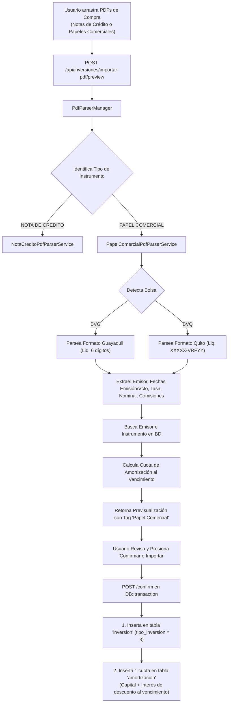
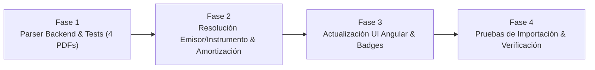

# Plan de Implementación: Extensión del Módulo de Importación PDF para Papeles Comerciales (Cero Cupón)

## 1. Resumen Ejecutivo y Objetivo
El objetivo es extender el motor de importación automática de liquidaciones bursátiles en PDF desarrollado en SIPRO para procesar compras de **Papel Comercial (Cero Cupón)** negociadas a través de **Santa Fe Casa de Valores S.A.** en la **Bolsa de Valores de Guayaquil (BVG)** y la **Bolsa de Valores de Quito (BVQ)**.

A diferencia de las Notas de Crédito (que no amortizan y se negocian para reventa en bloque), el Papel Comercial es un instrumento de renta fija corporativa a corto plazo que:
1. Pertenece a emisores corporativos privados (ej. **EMPAGRAN**, Pronaca, La Favorita, etc.).
2. Tiene una **Fecha de Emisión**, **Fecha de Vencimiento** y **Tasa/Rendimiento Nominal**.
3. Debe generar automáticamente **1 cuota de amortización al vencimiento** en la tabla `amortizacion`.

---

## 2. Flujo de Procesamiento y Decisión

---

## 3. Especificación Técnica de Componentes

### 3.1. Backend (Laravel 12 / PHP 8.2)

#### A. Nuevo Parser: `PapelComercialPdfParserService.php`
* **Implementa**: `PdfSettlementParserInterface`.
* **Criterio de activación (`canHandle`)**:
  * Detecta cadenas como `PAPEL COMERCIAL`, `CERO CUPON` o código SEB `PCO`.
* **Lógica de parsing para BVG**:
  * **Operación**: Patrón `Operación No:\s*([0-9]{6})`.
  * **Emisor**: Extrae el nombre corporativo (ej. `EMPACADORA GRUPO GRANMAR S.A. EMPAGRAN`).
  * **Fechas**: 
    * `Fecha de negociación` / `Fecha valor`.
    * `Emisión de título` (ej. `24/04/2026`).
    * `Vencimiento título` (ej. `09/04/2027`).
  * **Plazo**: Extrae `Plazo por vencer: ([0-9]+)`.
  * **Tasa / Rendimiento**: Extrae `Rend. Nominal: ([0-9.]+)` (ej. `9.00000000%`).
  * **Valores Financieros**: Nominal, Precio %, Valor Efectivo, Comisión Bolsa, Comisión Casa de Valores, Total Comprador Neto y Precio Neto %.
* **Lógica de parsing para BVQ**:
  * Utiliza los mismos anclajes estándar de la Bolsa de Quito analizados en las Notas de Crédito:
    * `Liquidación de contrato: Compra No. ([0-9]{4,6}\s*-\s*VRF[0-9]{1,3})`.
    * `Val. Nom. actual`, `Precio (%)`, `Valor efectivo (A)`.
    * `Fecha vencimiento`, `RDTO. Nominal (%)`, `Plazo por vencer`.
    * Comisiones `Bolsa(C)` y `Operador(D)`.

#### B. DTO Extendido: `ParsedSettlementDto.php`
Añadir soporte para atributos propios de Renta Fija con vencimiento:
* `fechaEmision`: `?string` (`YYYY-MM-DD`).
* `fechaVencimiento`: `?string` (`YYYY-MM-DD`).
* `emisorNombre`: `?string`.
* `tasaInteres`: `?float`.
* `plazoDias`: `?int`.

#### C. Registro en `PdfParserManager.php`
* Inyectar `PapelComercialPdfParserService` en el constructor del `PdfParserManager`.
* La detección es automática: el usuario puede subir al mismo tiempo PDFs de Notas de Crédito y de Papeles Comerciales sin tener que separar los archivos.

#### D. Actualización del Servicio de Importación: `InversionPdfImportService.php`
1. **Resolución de Emisor (`id_emisor`)**:
   * Consulta la tabla `emisor` buscando coincidencia en `nombre` o `razon_social` (ej. `EMPAGRAN`).
   * Si no se encuentra con exactitud, se retorna la lista de emisores para que el usuario pueda seleccionarlo en la interfaz.
2. **Resolución de Instrumento (`id_instrumento`)**:
   * Busca en la tabla `instrumento` donde `id_tipo_inversion = 3` (Papel Comercial), `id_emisor` coincidente y `fecha_vencimiento` idéntica.
   * Si ya existe (ej. ID `223` para EMPAGRAN al `2027-04-09`), lo asocia automáticamente.
   * Si no existe, el servicio genera un nuevo instrumento con la nomenclatura institucional de SIPRO: `YYYY-MM-DD [EMISOR] YYYY-MM-DD`.
3. **Cálculo de la Cuota de Amortización**:
   * Al ser *Cero Cupón*, los intereses se perciben por el diferencial de descuento al vencimiento:
     $$\text{Capital} = \text{Capital Invertido (Costo Total)}$$
     $$\text{Interés (Ganancia por Descuento)} = \text{Valor Nominal} - \text{Capital Invertido}$$
     $$\text{Total al Vencimiento} = \text{Valor Nominal}$$
4. **Persistencia Transaccional (`confirm`)**:
   * Inserta en `inversion`:
     * `id_tipo_inversion = 3`, `tasa_interes = dto->tasaInteres`, `fecha_compra`, `capital_invertido`, etc.
   * Inserta en `amortizacion`:
     * `numero_cuota = 1`, `fecha_pago = fecha_vencimiento`, `capital`, `interes`, `total`, `id_estado_amortizacion = 134` (Pendiente), `eliminado = 0`.

---

### 3.2. Frontend (Angular)

#### A. Adaptabilidad de la Interfaz Existente
No es necesario crear una pantalla separada. La pantalla recién creada [`/notas-credito/importar-pdf`](file:///c:/PROYECTOS/SIPRO_07/frontend/src/app/modules/notas-credito/importar-pdf/importar-pdf.component.ts) se evolucionará a un **Importador Inteligente de Liquidaciones Bursátiles**:
* **Badge de Instrumento**:
  * 🟢 `Nota de Crédito` (SRI)
  * 🔵 `Papel Comercial` (EMPAGRAN, etc.)
* **Columnas Dinámicas/Informativas**:
  * Columna **Emisor**: Muestra el emisor detectado con selector si es necesario.
  * Columna **Vencimiento**: Muestra la fecha de vencimiento (`2027-04-09`).
  * Columna **Tasa**: Muestra la tasa nominal (ej. `9.00%`).
  * Indicador de Amortización: Icono con tooltip *"Generará 1 cuota de amortización de \$1.475,00 al 09/04/2027"*.
* **Acceso en Navegación**:
  * Además del menú en *Notas de Crédito*, se añadirá un acceso directo en **Renta Fija > Importar Liquidaciones PDF** para facilitar el acceso desde ambos módulos.

---

## 4. Fases de Ejecución

### Fase 1: Servicio de Parsing de Papel Comercial (Backend)
- [x] Extender `ParsedSettlementDto` con campos de emisor, fechas de emisión/vencimiento y tasa.
- [x] Implementar `PapelComercialPdfParserService` con expresiones regulares para BVG (y estructura gemela para BVQ).
- [x] Crear prueba automatizada con los 4 PDFs reales de Papel Comercial (`376149`, `366433`, `365922`, `365921`).
- [x] Registrar el parser en `PdfParserManager`.

### Fase 2: Lógica de Instrumentos y Amortización Automática (Backend)
- [x] Implementar en `InversionPdfImportService` la búsqueda/creación automática de instrumentos de tipo `3` (Papel Comercial).
- [x] Implementar la generación de la cuota única de amortización en `confirm()` para inversiones de renta fija cero cupón.
- [x] Validar que las Notas de Crédito sigan operando sin amortizaciones.

### Fase 3: Ajustes en el Frontend (Angular)
- [x] Actualizar interfaces de TypeScript (`PreviewItem`) para incluir emisor, fecha de vencimiento y tasa.
- [x] Enriquecer la tabla de previsualización para mostrar el badge de tipo de título y fecha de vencimiento.
- [x] Agregar el acceso en el menú lateral bajo **Renta Fija > Carga Liquidaciones PDF**.

### Fase 4: Pruebas de Integración y Validación
- [x] Cargar simultáneamente un lote mixto (PDFs de Notas de Crédito y PDFs de Papel Comercial).
- [x] Confirmar que el sistema discrimina cada tipo, inserta en `inversion` con los tipos correctos (`91` vs `3`) y crea la amortización únicamente para los Papeles Comerciales.
- [x] Verificar que los vencimientos aparezcan correctamente en los reportes de **Vencimientos Mensuales / Semanales** y en **Patrimonio Consolidado**.

---

## 5. Criterios de Aceptación
1. **Detección Automática**: El sistema debe identificar el tipo de documento sin que el usuario tenga que seleccionar previamente si es Nota de Crédito o Papel Comercial.
2. **Cálculo Exacto de Amortización**: Para cada Papel Comercial importado, la cuota única creada en `amortizacion` debe sumar exactamente el Valor Nominal al vencimiento, desglosando con precisión el capital invertido y el interés de descuento.
3. **Manejo de Duplicados**: Si el Papel Comercial ya fue registrado previamente en la base de datos, el sistema lo marcará como `DUPLICADO` con su ID correspondiente.
