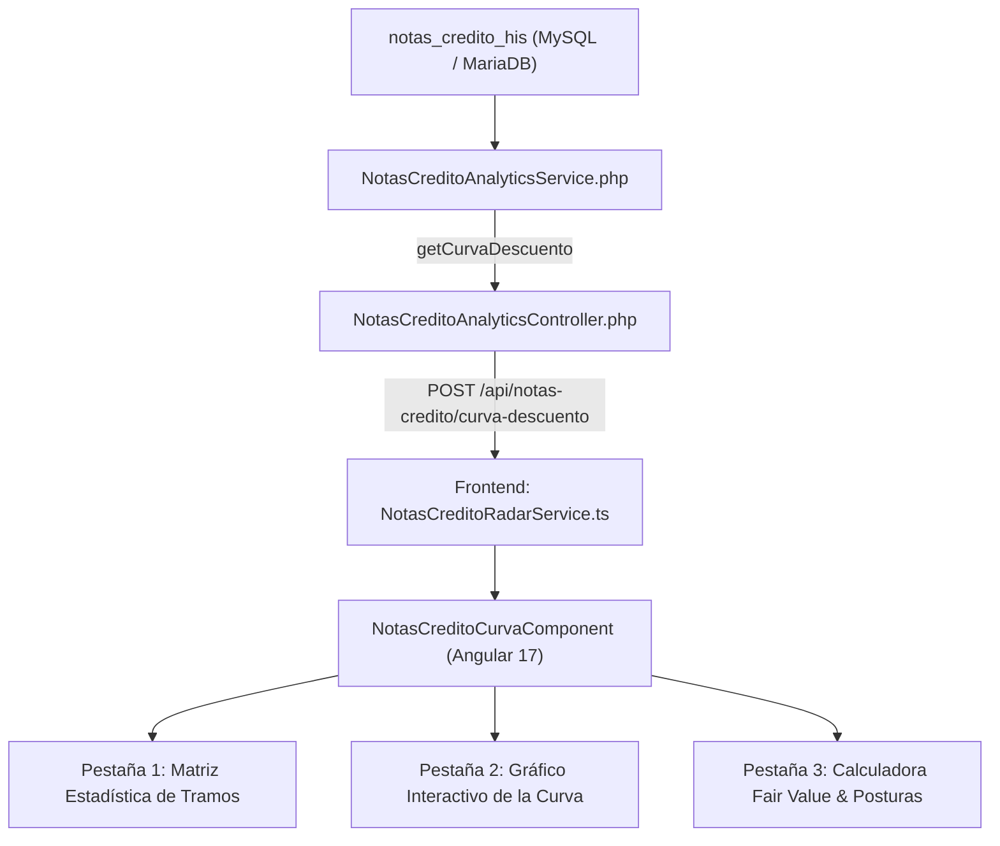

# Reporte 2: Matriz de Precios por Tramo de Monto y Curva de Descuento (Notas de Crédito SRI)

**SIPRO 07 — Inteligencia de Mercado Bursátil (BVG / BVQ)**  
**Fecha de Implementación:** Noviembre 2026  
**Fuente de Datos:** Tabla `notas_credito_his` (Base de Datos `inversion`)  
**Universo Analizado:** 68,665 transacciones históricas (2019 – 2026) por un volumen nominal superior a $5,410 Millones USD.

---

## 1. Resumen Ejecutivo y Objetivo Estratégico

El **Reporte 2** proporciona el sustento cuantitativo y gráfico para ejecutar con éxito la estrategia de **arbitraje y acumulación de Notas de Crédito del SRI**:

* **Objetivo de Negocio:** Determinar con rigor estadístico el **precio justo de compra** (*Fair Value*) para notas pequeñas de personas naturales y PYMES, y el **precio objetivo de salida mayorista** al colocarlas consolidadas ante tesorerías corporativas e inversionistas institucionales.
* **Hipótesis Validada:** Los datos confirman que las notas de bajo valor nominal cotizan a un precio porcentual significativamente menor (mayor tasa de descuento) que los paquetes consolidados de gran tamaño, abriendo un margen neto de arbitraje continuo de entre **+2.27 y +2.76 puntos porcentuales**.

---

## 2. Validación Empírica con Datos Históricos (68,665 Operaciones)

### A. Matriz Histórica Consolidada (2019 – 2026)

| Tramo Nominal | Perfil de Contribuyente | Operaciones (% Mercado) | Volumen Nominal Total ($) | P. Mínimo | **P25 (Compra Sugerida)** | Mediana P50 | Prom. Ponderado | **P75 (Venta Sugerida)** | P. Máximo | **Spread vs Mayorista** | **Ganancia por $10,000** |
| :--- | :--- | :---: | :---: | :---: | :---: | :---: | :---: | :---: | :---: | :---: | :---: |
| **1. Micro (< $2,000)** | Personas Naturales / Menudeo | 16,839 *(24.5%)* | $16,919,811 *(0.3%)* | 75.13% | **97.00%** | 98.15% | 98.22% | 99.00% | 100.00% | **+2.76 pts** | **+$276.00 USD** |
| **2. Pequeño ($2k – $10k)** | PYMES y Contribuyentes Medios | 17,853 *(26.0%)* | $88,787,519 *(1.6%)* | 85.00% | **98.45%** | 99.05% | 98.70% | 99.20% | 100.00% | **+1.31 pts** | **+$131.00 USD** |
| **3. Mediano ($10k – $50k)** | Empresas Medianas | 17,945 *(26.1%)* | $431,330,835 *(8.0%)* | 88.00% | **98.75%** | 99.30% | 98.87% | 99.51% | 100.00% | **+1.01 pts** | **+$101.00 USD** |
| **4. Institucional (> $50k)** | Tesorerías / Grandes Corporaciones | 16,078 *(23.4%)* | $4,873,310,201 *(90.1%)* | 87.85% | **98.74%** | 99.63% | 98.99% | **99.76%** | 99.92% | *Referencia* | *Base Salida* |

---

### B. Comportamiento en el Año Reciente (2026)

Analizando las **16,010 transacciones cerradas en el año 2026** ($1,061.9M negociados):
* **Precio Percentil 25 en Micro (< $2k):** `96.50%`
* **Precio Percentil 75 Institucional (> $50k):** `98.77%`
* **Spread Máximo Explotable 2026:** **+2.27 puntos porcentuales** (Ganancia bruta: **+$227 USD** por cada $10,000 acumulados).

---

## 3. Arquitectura Técnica Implementada

### 3.1. Backend (Laravel API)

1. **Servicio [`NotasCreditoAnalyticsService.php`](file:///c:/PROYECTOS/SIPRO_07/backend/app/Services/NotasCreditoAnalyticsService.php):**
   * **Método `getCurvaDescuento(array $filters)`**:
     * Soporte de presets temporales: `todos` (2019-2026), `2026`, `12meses`, `90dias`, `30dias` y `personalizado`.
     * Filtros de mercado: Bolsa (`TODAS`, `BVG`, `BVQ`) y Título (`NOTA DE CREDITO`, `NOTA DE CREDITO ISD`).
     * Cálculo de agregados globales: Total operaciones, volumen nominal, efectivo, ahorro total de mercado, promedio simple y ponderado.
     * Segmentación en los 4 tramos operativos y cómputo de percentiles reales ($P_{10}$, $P_{25}$, $P_{50}$, $P_{75}$, $P_{90}$, mínimos y máximos).
     * Cálculo de spread vs institucional y proyección de ganancia por cada $10,000 negociados.
     * Generación de la serie de datos para el gráfico de líneas (bandas de compra, promedio y venta).
     * Muestra representativa aleatoria de 150 puntos para el análisis de dispersión.

2. **Controlador [`NotasCreditoAnalyticsController.php`](file:///c:/PROYECTOS/SIPRO_07/backend/app/Http/Controllers/API/NotasCreditoAnalyticsController.php):**
   * Endpoint `getCurvaDescuento(Request $request)` que valida y retorna la respuesta estructurada en formato JSON estándar.

3. **Ruta API [`backend/routes/api.php`](file:///c:/PROYECTOS/SIPRO_07/backend/routes/api.php):**
   * Registrada como: `POST /api/notas-credito/curva-descuento`.

---

### 3.2. Frontend (Angular 17 + PrimeNG + Chart.js)

1. **Servicio Angular [`notas-credito-radar.service.ts`](file:///c:/PROYECTOS/SIPRO_07/frontend/src/app/core/notas-credito-radar.service.ts):**
   * Interfaces fuertemente tipadas:
     * `TramoCurvaItem`: métricas completas por tramo (ops, nominal, percentiles, spreads).
     * `CurvaDescuentoKpis`: indicadores agregados de resumen.
     * `CurvaDescuentoResponse`: respuesta completa de la API.
   * Método `getCurvaDescuento(filters: any): Observable<CurvaDescuentoResponse>`.

2. **Componente [`NotasCreditoCurvaComponent`](file:///c:/PROYECTOS/SIPRO_07/frontend/src/app/modules/notas-credito-curva/):**
   * **Controlador (`notas-credito-curva.component.ts`)**:
     * Carga reactiva de datos al cambiar de preset o bolsa.
     * Configuración del gráfico Chart.js con tooltips personalizados y formato porcentual en el eje Y.
     * Lógica de la calculadora de *Fair Value*: asignación automática de tramo, cálculo de inversión total, ingreso neto de venta, utilidad neta en USD, ROI directo y TIR anualizada.
     * Exportación de informes en formatos **Excel (.xlsx)** y **PDF** con tabla formateada.
   * **Plantilla (`notas-credito-curva.component.html`)**:
     * Header con enlaces de navegación y botones de exportación.
     * Barra de botones de filtro rápido tipo píldora (`btn-xs rounded-pill`).
     * 4 tarjetas KPI hero destacadas con bordes laterales de color según categoría.
     * Navegación por pestañas segmentadas utilizando el estándar SIPRO (`<p-tabView>`).
     * Tablas con números alineados a la derecha, formato de moneda, porcentajes a 2 decimales y badges de alto contraste.
   * **Estilos (`notas-credito-curva.component.css`)**:
     * Paleta de colores institucional SIPRO: Verde esmeralda (`#059669`), Azul corporativo (`#0284c7`), Ámbar (`#d97706`) y Púrpura institucional (`#7c3aed`).
     * Integración con las variables globales de PrimeNG (`:host ::ng-deep`).

3. **Rutas y Menú Lateral:**
   * Registrada en [`app.routes.ts`](file:///c:/PROYECTOS/SIPRO_07/frontend/src/app/app.routes.ts): `/notas-credito/curva-descuento`.
   * Integrada en [`sidebar.component.ts`](file:///c:/PROYECTOS/SIPRO_07/frontend/src/app/layout/sidebar/sidebar.component.ts) bajo el menú **Notas de Crédito**:
     * *Radar de Oportunidades*
     * **Curva de Descuento (Tramos)** 📈
     * *Listado de Ventas*
     * *Venta Notas Crédito*
     * *Análisis de Rendimiento*

---

## 4. Funcionalidades del Módulo

### 4.1. Barra de Control y Presets Temporales
Permite alternar instantáneamente la ventana de análisis sin recargar la página:
* **Todo el Histórico (2019-2026):** Visión macro de largo plazo con 68k+ operaciones.
* **Año 2026 (Reciente):** Condiciones vigentes del mercado en el último año.
* **Últimos 12 Meses:** Visión de mediano plazo para capturar estacionalidad tributaria.
* **Últimos 90 Días:** Condiciones de liquidez inmediata del trimestre.
* **Personalizado:** Selección de fechas inicio y fin específicas.
* **Selector de Bolsa:** Filtrar por transacciones de Guayaquil (**BVG**), Quito (**BVQ**) o consolidado (**TODAS**).

---

### 4.2. Tarjetas Resumen KPI
1. **Spread Máx. de Arbitraje:** Muestra la brecha entre el $P_{25}$ del tramo Micro y el $P_{75}$ del tramo Institucional (ej. `+2.76 pts`).
2. **P25 Compra Micro (< $2k):** Postura máxima recomendada para comprar notas pequeñas (ej. `97.00%`).
3. **P75 Venta Mayorista (> $50k):** Precio institucional al que las tesorerías absorben paquetes consolidados (ej. `99.76%`).
4. **Volumen del Período:** Millones de dólares transados y número de operaciones computadas.

---

### 4.3. Pestaña 1: Matriz Estadística de Tramos
* Detalla para cada tramo:
  * Conteo de operaciones y su representatividad en el mercado (% ops).
  * Monto nominal transado y porcentaje del volumen global (% nominal).
  * Precio mínimo registrado.
  * **$P_{25}$ (Compra sugerida)**: Columna resaltada en verde que indica el precio donde se concentra el 25% más barato de las transacciones.
  * Mediana ($P_{50}$) y Precio Promedio Ponderado por volumen.
  * **$P_{75}$ (Venta sugerida)**: Columna resaltada en azul que indica el precio objetivo al colocar las notas.
  * Precio máximo registrado.
  * **Spread vs Mayorista:** Margen bruto garantizado al consolidar notas de este tramo.
  * **Ganancia Est. por $10,000:** Utilidad bruta en dólares por cada $10k negociados.
  * Botón de acción **`Evaluar`**: Carga de forma automática el tramo seleccionado en la Calculadora de Precio Justo.

---

### 4.4. Pestaña 2: Gráfico de la Curva de Descuento
* Gráfico de líneas interactivo con PrimeNG Chart (`Chart.js`):
  * **Línea Verde (Banda de Compra - P25):** Evolución del precio de entrada sugerido según crece el nominal.
  * **Línea Azul (Promedio Ponderado):** Centro del mercado para cada tramo.
  * **Línea Púrpura (Banda de Venta - P75):** Techo de realización institucional.
* Permite observar claramente la **pendiente ascendente**: cómo el precio sube progresivamente desde 96.5% - 97.0% en notas de personas naturales hasta 99.0% - 99.7% en notas corporativas mayores a $50k.

---

### 4.5. Pestaña 3: Calculadora de Precio Justo (*Fair Value & Postura*)
Diseñada para el operador de mesa al momento de negociar una nota:
1. **Entradas:**
   * Monto Nominal a negociar (ej. `$4,500 USD`).
   * Precio de Compra Propuesto (se precarga con el $P_{25}$ del tramo detectado).
   * Precio de Venta Mayorista (se precarga con el $P_{75}$ Institucional).
   * Comisiones de compra y venta (% de la Casa de Valores).
   * Días estimados de rotación / consolidación (ej. 25 días).
2. **Resultados Proyectados en Tiempo Real:**
   * Tramo y perfil asignado automáticamente.
   * Inversión requerida (Efectivo de compra + comisiones).
   * Ingreso neto proyectado de la venta consolidada.
   * **Utilidad Neta en USD**.
   * **ROI % Directo** de la operación.
   * **TIR Anualizada** según la velocidad de rotación.
   * **Veredicto Automático:**
     * `★ Oportunidad Excelente de Arbitraje` (ROI $\ge$ 1.2%).
     * `✓ Operación Viable con Margen Razonable` (ROI entre 0.7% y 1.2%).
     * `⚠ Margen Ajustado / Poco Spread` (ROI < 0.7%).
   * **Recomendación para el Operador:** Texto dinámico indicando el precio mínimo de postura y el techo para no erosionar el margen.

---

## 5. Manual de Operación para la Mesa de Dinero

1. **Fase de Acumulación (Compra de Notas Dispersas):**
   * Consultar la **Matriz de Tramos** para verificar el $P_{25}$ vigente del período.
   * Emitir posturas de compra a Casas de Valores en el tramo **Micro (< $2k)** entre **96.50% y 97.00%**.
   * En el tramo **Pequeño ($2k-$10k)**, el techo de compra no debe superar **98.45%**.
   * Registrar cada compra como una inversión individual en SIPRO.

2. **Fase de Consolidación (Agrupación):**
   * Una vez acumulado un saldo mayor a **$50,000 USD** entre múltiples notas, utilizar el módulo de **Venta Agrupada** de SIPRO ([`/venta-agrupada`](file:///c:/PROYECTOS/SIPRO_07/frontend/src/app/modules/venta-agrupada/)).

3. **Fase de Realización (Venta Institucional):**
   * Ofrecer el paquete consolidado a Casas de Valores compradoras de volumen institucional (ej. Santa Fe, Fiduvalor, Futurocapital) a un precio entre **98.90% y 99.70%**.
   * Con esta operativa, el spread neto promedio capturado es de **+1.50% a +2.50%** por cada ciclo de rotación mensual.

---

## 6. Archivos del Módulo

| Componente | Ruta en el Repositorio |
| :--- | :--- |
| **Servicio Backend** | [`backend/app/Services/NotasCreditoAnalyticsService.php`](file:///c:/PROYECTOS/SIPRO_07/backend/app/Services/NotasCreditoAnalyticsService.php) |
| **Controlador API** | [`backend/app/Http/Controllers/API/NotasCreditoAnalyticsController.php`](file:///c:/PROYECTOS/SIPRO_07/backend/app/Http/Controllers/API/NotasCreditoAnalyticsController.php) |
| **Rutas API** | [`backend/routes/api.php`](file:///c:/PROYECTOS/SIPRO_07/backend/routes/api.php) |
| **Servicio Frontend** | [`frontend/src/app/core/notas-credito-radar.service.ts`](file:///c:/PROYECTOS/SIPRO_07/frontend/src/app/core/notas-credito-radar.service.ts) |
| **Componente TS** | [`frontend/src/app/modules/notas-credito-curva/notas-credito-curva.component.ts`](file:///c:/PROYECTOS/SIPRO_07/frontend/src/app/modules/notas-credito-curva/notas-credito-curva.component.ts) |
| **Plantilla HTML** | [`frontend/src/app/modules/notas-credito-curva/notas-credito-curva.component.html`](file:///c:/PROYECTOS/SIPRO_07/frontend/src/app/modules/notas-credito-curva/notas-credito-curva.component.html) |
| **Estilos CSS** | [`frontend/src/app/modules/notas-credito-curva/notas-credito-curva.component.css`](file:///c:/PROYECTOS/SIPRO_07/frontend/src/app/modules/notas-credito-curva/notas-credito-curva.component.css) |
| **Rutas Angular** | [`frontend/src/app/app.routes.ts`](file:///c:/PROYECTOS/SIPRO_07/frontend/src/app/app.routes.ts) |
| **Menú Lateral** | [`frontend/src/app/layout/sidebar/sidebar.component.ts`](file:///c:/PROYECTOS/SIPRO_07/frontend/src/app/layout/sidebar/sidebar.component.ts) |

