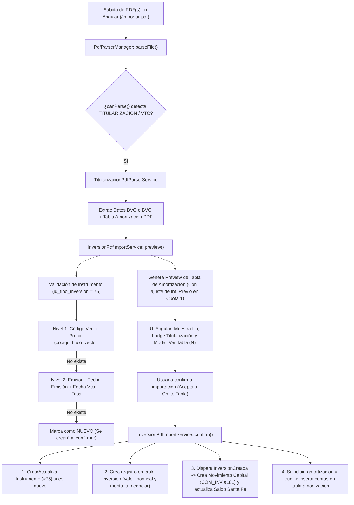

# Plan de Implementación: Carga Automática de Liquidaciones PDF de Titularizaciones (`id_tipo_inversion = 75`)

## 1. Resumen Ejecutivo y Hallazgos del Análisis Documental

Se analizaron los **3 expedientes electrónicos firmados** de compras de **Valores de Titularización Crediticia (`VTC`)** realizados a través de **Santa Fe Casa de Valores S.A.** en la **Bolsa de Valores de Guayaquil (BVG)**:

| # | Archivo PDF | Bolsa / Liq. | Fecha Compra | Comitente (Propietario) | Emisor / Fideicomiso | Vector Precio | Nominal Original | Monto a Negociar (`87.55%`) | Precio Compra | Valor Efectivo (A) | Interés Devengado (B) | Comisiones (C + D) | Capital Invertido (`A+C+D`) | Total Liq. (`A+B+C+D`) | Cupones Vigentes |
| :-: | :--- | :---: | :---: | :--- | :--- | :---: | ---: | ---: | ---: | ---: | ---: | ---: | ---: | ---: | :---: |
| **1** | `2024_09_30_LIQ_332349_CompraTitularizacionNuevoTransporte_OrellanaCristian-signed.pdf` | **BVG** `332349` | `2024-09-30` | Cristian Alfredo Orellana Cepeda (`#2`) | `NUEVO TRANSPORTE` (`#150`) | `605030100001281212` | `$24,170.00` | **`$21,160.84`** | `93.2154%` | `$19,725.15` | `$89.93` *(18d)* | `$17.75 + $64.03` | **`$19,806.93`** | **`$19,896.86`** | **17 trimestrales** (`#6`–`#22`) |
| **2** | `2024_09_30_LIQ_332350_CompraTitularizacionNuevoTransporte_CepedaIsabel-signed.pdf` | **BVG** `332350` | `2024-09-30` | Isabel Cristina Cepeda Campaña (`#3`) | `NUEVO TRANSPORTE` (`#150`) | `605030100001281212` | `$16,535.00` | **`$14,476.39`** | `93.2154%` | `$13,494.22` | `$61.52` *(18d)* | `$12.14 + $44.39` | **`$13,550.75`** | **`$13,612.27`** | **17 trimestrales** (`#6`–`#22`) |
| **3** | `2024_10_07_LIQ_332596_CompraTitularizacionNuevoTransporte_OrellanaJhon-signed.pdf` | **BVG** `332596` | `2024-10-07` | Jhon Alfredo Orellana Ocaña (`#1`) | `NUEVO TRANSPORTE` (`#150`) | `605030100001281212` | `$8,150.00` | **`$7,135.33`** | `93.2656%` | `$6,654.81` | `$42.12` *(25d)* | `$5.99 + $19.96` | **`$6,680.76`** | **`$6,722.88`** | **17 trimestrales** (`#6`–`#22`) |

### Particularidades Clave de las Titularizaciones frente a Bonos y Obligaciones

1. **Identificación del Tipo de Título (`TITULARIZACION`, `id_tipo_inversion = 75`)**:
   - En **BVG**: `TÍTULO VALOR: VALORES TITULARIZACION CREDITICIA (2) - CLASE: UNICA - SERIE: A` (o variantes con `TITULARIZACION`).
   - En **Santa Fe / BVQ**: `Código SEB: VTC`, `Tipo de Documento: VTC-NTG-SERIE A`, `Emisor: FIDEICOMISO TITULARIZACION...` o `Tipo instrumento: VALORES DE TITULARIZACION / TITULARIZACION`.
2. **Distinción entre `valor_nominal` (Original) y `monto_a_negociar` (Saldo Vigente por Amortizar)**:
   - En las Titularizaciones negociadas luego de haber pagado cupones iniciales (`Saldo por amortizar: 87.55%`), la tabla `inversion` almacena:
     - `valor_nominal`: el Valor Nominal Original del título (ej. `$16,535.00` en Liq. `332350`).
     - `monto_a_negociar`: el Saldo por Amortizar vigente (ej. `$14,476.39` en Liq. `332350`), sobre el cual se calcula el Precio de Compra (`93.21538218%`), el Valor Efectivo (`$13,494.22`) y las cuotas restantes de amortización.
3. **Sistema de Amortización Francés (Cuota Total Constante) con Período de Gracia**:
   - A diferencia de los Bonos (pago al vencimiento/anual) y las Obligaciones (amortización alemana de capital constante), las Titularizaciones como `NUEVO TRANSPORTE` utilizan **amortización francesa (cuota trimestral constante)** y pueden incluir cupones iniciales de gracia (`#1` y `#2` con `Amortización = 0.00`).
   - En la liquidación `332350`, por ejemplo, el cupón `#6` (`2024-12-12`) tiene `Interés = $307.62` y `Amortización = $715.97` ( y al restar el interés acumulado previo de `$61.52` pagado al vendedor y sumarlo al retorno de capital en la cuota `#1` de SIPRO, da exactamente **`Interés = $246.10`** y **`Capital = $777.49`**, tal como está registrado en `amortizacion` para la `Inversión #238`).
   - Por ello, cuando el PDF incluye la tabla de amortización oficial de la bolsa (o mediante el cálculo francés `'F'` en `AmortizacionGeneracionController`), el sistema debe construir la previsualización exacta aplicando la regla de SIPRO en la primera cuota vigente (`interes_1 = interes_cupon - interes_acumulado_previo`, `capital_1 = amortizacion_cupon + interes_acumulado_previo`) y permitir al usuario **visualizarla, aceptarla u omitirla** antes de confirmar.

---

## 2. Arquitectura de la Solución Propuesta

---

## 3. Detalle de Componentes a Implementar / Modificar

### Fase 1: Backend — DTO y Parser de PDF para Titularizaciones (`BVG` y `BVQ`)

1. **[ParsedSettlementDto.php](file:///c:/PROYECTOS/SIPRO_07/backend/app/Services/PdfParsers/DTOs/ParsedSettlementDto.php)**:
   - Agregar las propiedades opcionales:
     - `?float $montoANegociar = null` (para conservar tanto el `valorNominal` original como el `montoANegociar` vigente cuando el título tiene `Saldo por amortizar < 100%`).
     - `?array $cuotasPdf = null` (para transportar las filas vigentes `[nro_cupon, fecha_pago, interes, amortizacion, capital_reducido, flujo]` extraídas directamente de la tabla del PDF cuando esté presente).

2. **Nuevo Servicio [TitularizacionPdfParserService.php](file:///c:/PROYECTOS/SIPRO_07/backend/app/Services/PdfParsers/TitularizacionPdfParserService.php)**:
   - **`canParse(string $rawText): bool`**:
     - Detecta si el documento contiene `VALORES TITULARIZACION`, `TITULARIZACION CREDITICIA`, `FIDEICOMISO TITULARIZACION`, `Código SEB: VTC` o `VTC-`.
   - **Extracción Dual BVG / BVQ**:
     - **Bolsa de Guayaquil (`BVG`)**:
       - `liquidacion`: `OPERACIÓN No: (\d+)`
       - `fechaNegociacion`: `FECHA DE NEGOCIACIÓN: DD/MM/YYYY`
       - `emisorNombre`: `EMISOR: FIDEICOMISO TITULARIZACION PROYECTO...` (limpiando prefijos como `FIDEICOMISO TITULARIZACION PROYECTO` y sufijos geográficos como `GUAYAQUIL` para hacer match limpio con `NUEVO TRANSPORTE` en la tabla `emisor`).
       - `codigoVector`: `CÓDIGO VECTOR PRECIO : (\d+)`
       - `codigoSeb`: `VTC`
       - `fechaEmision` y `fechaVencimiento`: `EMISIÓN DE TÍTULO: DD/MM/YYYY` y `VENCIMIENTO TÍTULO: DD/MM/YYYY`
       - `fechaPrimerPago`: `VCTO. CUPÓN: DD/MM/YYYY`
       - `valorNominal`: `VALOR NOMINAL: $ X,XXX.XX` (Nominal original) y `montoANegociar`: `MONTO A NEGOCIAR: $ X,XXX.XX` (Saldo vigente por amortizar).
       - `precioCompra`, `tasaInteres`, `rendimientoNominal`, `rendimientoEfectivo`, `valorEfectivo (A)`, `interesDevengado (B)`, `comisionBolsa (C)`, `comisionCasaValores (D)`, `totalInvertido (A+C+D)`, `valorConInteres (A+B+C+D)`.
     - **Bolsa de Quito (`BVQ`)**:
       - Soporte homólogo al formato tabular de la BVQ (`No. liquidación`, `Val. Nom. orig.`, `Val. Nom. actual`, `Valor efectivo`, `Interés transcurrido`, comisiones y total a pagar).
   - **Extracción de Cuotas Vigentes desde la Tabla del PDF (`extraerCuotasVigentesPdf()`)**:
     - Parsea las filas de la `TABLA DE AMORTIZACIÓN` del PDF cuyas fechas de vencimiento sean mayores o iguales a la `fechaNegociacion` (`fecha_compra`), capturando `numero_cuota`, `fecha_pago`, `interes`, `amortizacion` (capital) y `capital_reducido`.

3. **[PdfParserManager.php](file:///c:/PROYECTOS/SIPRO_07/backend/app/Services/PdfParsers/PdfParserManager.php)**:
   - Registrar `TitularizacionPdfParserService` en el constructor para que sea evaluado automáticamente al subir cualquier lote de PDFs.

---

### Fase 2: Backend — Validación de Instrumento, Movimiento de Capital y Tabla de Amortización

4. **[InversionPdfImportService.php](file:///c:/PROYECTOS/SIPRO_07/backend/app/Services/InversionPdfImportService.php)**:
   - **Validación de Instrumento en 2 Niveles (`buscarInstrumentoTitularizacion()`)**:
     - **Nivel 1 (`VECTOR`)**: Busca en `instrumento` (`id_tipo_inversion = 75`, `activo = 1`) donde `codigo_titulo_vector` coincida con el vector del PDF (con o sin prefijo `'a'`, ej. `605030100001281212` -> `Inst. #3: 2023-06-12 NUEVO TRANSPORTE 2028-12-12`).
     - **Nivel 2 (`FECHAS_TASA`)**: Si el PDF no trae código vector, busca por `id_emisor + fecha_emision + fecha_vencimiento + tasa_referencial` dentro de `id_tipo_inversion = 75`.
     - **Creación Automática (`NUEVO`)**: Si no existe el instrumento, en `confirm()` lo crea con `id_tipo_inversion = 75`, `codigo_titulo = 'INV_75_YYYYMMDD'`, `nombre = 'YYYY-MM-DD EMISOR YYYY-MM-DD'`, `codigo_titulo_vector = 'a' . $codigoVector` y `codigo_seb = 'VTC'`.
   - **Resolución Inteligente del Emisor (`resolverEmisor()`)**:
     - Mejorar `resolverEmisor()` para que nombres largos en el PDF como `"FIDEICOMISO TITULARIZACION PROYECTO NUEVO TRANSPORTE GUAYAQUIL"` coincidan automáticamente con el emisor `"NUEVO TRANSPORTE"` (`id_emisor = 150`) registrado en el catálogo.
   - **Previsualización y Generación de Tabla de Amortización**:
     - Si el PDF trae la tabla de amortización oficial (`$dto->cuotasPdf`), construye la estructura `tabla_amortizacion_preview` aplicando en la **primera cuota vigente** el ajuste contable de SIPRO por el interés acumulado previo (`interes_parcial = interes_pdf - interes_devengado`, `capital_retorno = amortizacion_pdf + interes_devengado`) y distribuyendo proporcionalmente el descuento/premio si corresponde, o bien usando `AmortizacionGeneracionController` con `tipo_amortizacion = 'F'` (Francés) como fallback.
     - En `confirm()`, si `incluir_amortizacion === true`, guarda las cuotas validadas en la tabla `amortizacion` con estado `134` (`Pendiente`).
   - **Registro en `inversion` y `movimiento_capital`**:
     - Guarda `valor_nominal` (nominal original, ej. `$16,535.00`) y `monto_a_negociar` (saldo vigente negociado, ej. `$14,476.39`), manteniendo el 100% de consistencia con los registros históricos `Inv #226`–`#240` del instrumento `#3`.
     - Dispara `event(new InversionCreada($inversion))`: el listener [CrearMovimientoCompraInversion.php](file:///c:/PROYECTOS/SIPRO_07/backend/app/Listeners/CrearMovimientoCompraInversion.php#L125-L127) **ya tiene configurado el caso `case 'TIT': $tipoStr = 'Titularización'`** y registrará automáticamente el egreso `COM_INV` (`id_tipo_movimiento = 181`) por `valor_con_interes` (`A + B + C + D`) con descripción `"Compra de Titularización 2028-12-12"`, actualizando además el saldo de **Fondos en Santa Fe** en `otro_valor`.

---

### Fase 3: Frontend Angular — Visualización, Distintivos y Modal de Amortización

5. **[pdf-import.service.ts](file:///c:/PROYECTOS/SIPRO_07/frontend/src/app/core/pdf-import.service.ts)**:
   - Añadir `'TITULARIZACION'` al tipo `tipo_titulo` en `PreviewItem`.
   - Añadir `monto_a_negociar?: number | null;` en `PreviewItem`.
   - Añadir `titularizaciones?: number;` en `PreviewResponse.data.resumen`.
6. **[importar-pdf.component.ts](file:///c:/PROYECTOS/SIPRO_07/frontend/src/app/modules/notas-credito/importar-pdf/importar-pdf.component.ts)** e **[importar-pdf.component.html](file:///c:/PROYECTOS/SIPRO_07/frontend/src/app/modules/notas-credito/importar-pdf/importar-pdf.component.html)**:
   - Mostrar el contador de `Titularizaciones` en las tarjetas de resumen y en la notificación Toast.
   - Mostrar badge distintivo para `TITULARIZACION` (`VTC / Titularización`), el match del instrumento (`Inst. #3 (Vector)` o `Fechas+Tasa`), el `Monto a Negociar` cuando difiera del `Valor Nominal Original`, y habilitar el botón **`Ver Tabla (17)`** con la opción de **Aceptar** u **Omitir** la tabla de amortización antes de confirmar.

---

## 4. Plan de Pruebas y Verificación

1. **Prueba automatizada con los 3 PDFs reales (`332349`, `332350`, `332596`)**:
   - Verificar que `preview()` detecte los 3 archivos como `TITULARIZACION` (`BVG`), identifique a Cristian Orellana (`#2`), Isabel Cepeda (`#3`) y Jhon Orellana (`#1`), vincule el Emisor `#150` (`NUEVO TRANSPORTE`) y el Instrumento `#3` (`2023-06-12 NUEVO TRANSPORTE 2028-12-12`) por `VECTOR` (`605030100001281212`), detecte que las 3 liquidaciones ya existen en BD (`Inv #237`, `#238`, `#239`) y genere las **17 cuotas trimestrales vigentes** en `tabla_amortizacion_preview`.
   - Verificar que en la primera cuota vigente (`2024-12-12`) de la Liq. `332350`, la previsualización muestre exactamente `Interés = $246.10` (`$307.62 - $61.52`) y `Capital = $777.49` (`$715.97 + $61.52`), idéntico a la tabla `amortizacion` de `Inv #238`.
   - Probar `confirm()` dentro de una transacción con `DB::rollBack()` verificando la creación de `inversion`, las 17 cuotas en `amortizacion` y el egreso en `movimiento_capital` (`"Compra de Titularización 2028-12-12"`).
2. **Compilación Frontend**:
   - Ejecutar `npx tsc --noEmit` en `frontend` para garantizar cero errores de tipos en TypeScript.

